# Unified Service Scheduler. System Architecture Plan.

**Project:** Unified Service Scheduler.
**Domain:** Automotive Retail and Workshop Management.
**Target Role:** Principal Software Engineer.
**Sprint:** 1 week.
**Author:** AI Architect and Engineering Team.
**Language standard:** ASD-STE100 Simplified Technical English.

---

## Table of Contents

1. [Executive Summary](#1-executive-summary)
2. [Domain Analysis](#2-domain-analysis)
3. [User Roles and Use Cases](#3-user-roles-and-use-cases)
4. [Data Model and Workshop Taxonomy](#4-data-model-and-workshop-taxonomy)
5. [Slot Availability: Design Decision](#5-slot-availability-design-decision)
6. [Service Constraint Engine: Declarative Java Rules](#6-service-constraint-engine-declarative-java-rules)
7. [Architecture Decisions (ADRs)](#7-architecture-decisions)
8. [System Architecture](#8-system-architecture)
9. [State Machines](#9-state-machines)
10. [Event-Driven Architecture and Outbox Pattern](#10-event-driven-architecture-and-outbox-pattern)
11. [Security Architecture](#11-security-architecture)
12. [Cache Strategy](#12-cache-strategy)
13. [Observability](#13-observability)
14. [API Design](#14-api-design)
15. [CI/CD Strategy](#15-cicd-strategy)
16. [Sprint Roadmap](#16-sprint-roadmap)
17. [Discussion Checkpoints](#17-discussion-checkpoints)
18. [How AI Assisted the Design Phase](#18-how-ai-assisted-the-design-phase)
19. [Architecture Diagrams](#19-architecture-diagrams)

---

## 1. Executive Summary

Automotive retail platforms manage customer and vehicle ownership lifecycles. Service scheduling is the highest-frequency daily operation in workshop management.

A Senior Developer builds a booking form with a calendar.
A **Principal Software Engineer** addresses the root business problem:

> Automotive service departments lose revenue every day. They cannot match service demand to workshop capacity in real time. Double-bookings, no-shows, and skill mismatches cost $200-$800 per slot daily.

This architecture plan designs a production-grade service scheduler. It solves capacity matching with mathematical certainty. It provides an extensible platform for workshop operations.

**Core Requirements (CR):**

| CR | Requirement | Principal-Level Solution |
|---|---|---|
| CR-1 | Customer or advisor books a service appointment | Constraint-based slot search, PostgreSQL EXCLUDE overlap gates, UUID v4 idempotency. |
| CR-2 | System assigns the right technician and bay | Composable Java rule engine, relational metadata, multi-resource matching. |
| CR-3 | Service managers see the schedule in real time | Direct cookie-authenticated SSE push, single active stream per phone, slot cache invalidation. |
| CR-4 | Appointments move through states with audit | State machine enforcement, AFTER_COMMIT event bus, outbox pattern, communication log. |

---

## 2. Domain Analysis

### 2.1 Workshop Capacity Model

A dealership workshop operates a constant set of workshop bays. Each bay holds one service job at a time. Multiple bays run concurrently.

```
DEALERSHIP
  |-- Inlined operating hours, slot interval, and auto-confirm config
  |-- (N) VEHICLES (catalog of brands, models, and types)
  \-- (N) WORKSHOP_BAYS
           \-- Each bay: 1 job at a time, N concurrent jobs across all bays
```

At 09:00 on 2026-10-23:
- Bay B1 executes an oil change for Vehicle A.
- Bay B2 executes a tyre replacement for Vehicle B.
- Bay B3 executes a transmission overhaul for Vehicle C.

Three service jobs execute at the same time because three bays are available. This is workshop concurrency.

### 2.2 Business Context

```
MORNING (08:00)   Service advisor checks 12 booked slots for the day.
09:00             Customer selects vehicle and service type, receiving instant catalog cost estimate. Status: REQUESTED.
09:05             Dealership auto-confirms or manager confirms appointment. Status: CONFIRMED.
09:15             Customer arrives on site. Manager inspects vehicle and agrees face-to-face deal. Status: CHECKED_IN.
                  (If customer rejects deal or info mismatches: Manager marks status as NO_SHOW).
10:00             First service job starts in assigned bay. Status: IN_PROGRESS.
14:00             Manager monitors live bay schedules through real-time SSE dashboard.
16:30             Work finishes. Manager issues invoice with final agreed cost. Status: INVOICED.
```

The system must handle:

1. **Concurrent booking attempts.** Two customers or advisors book the same bay or vehicle at the same second.
2. **Real-time schedule visibility.** Bay assignments and status updates propagate to managers immediately.
3. **Resource constraint matching.** A brake overhaul requires a lift bay and a certified technician.
4. **Multi-job appointments.** One customer visit produces several service jobs across different bays.

---

## 3. User Roles and Use Cases

### 3.1 Role Summary & RBAC

The scheduler enforces role-based access control (RBAC) across four authenticated roles:

| Role | Scope | Identity & Auth | Key Permissions |
|---|---|---|---|
| `ADMIN` | System & All Dealerships | System administrator (Phone OTP -> JWT httpOnly Cookie) | All `MANAGER` permissions across all dealerships, plus manage dealerships, global dealership configuration, staff accounts, and system settings. |
| `MANAGER` | Assigned Dealership | Dealership staff, admin-provisioned (Phone OTP -> JWT httpOnly Cookie) | Full access and all permissions for specific assigned dealership: appointments, walk-in registration, schedules, bays, technicians, check-in, estimates, reports. |
| `TECHNICIAN` | Assigned Jobs | Workshop technician, admin-provisioned (Phone OTP -> JWT httpOnly Cookie) | View assigned jobs, update job status (`PENDING -> IN_PROGRESS -> ON_HOLD -> DONE`), log inspection notes. |
| `CUSTOMER` | Own Records | Vehicle owner, self-registered or staff-registered (Phone OTP -> JWT httpOnly Cookie) | Book appointments, view own appointments, accept cost estimates, cancel own appointments before `CHECKED_IN`, view own vehicle history. |

Internal background schedulers and outbox relays execute in-process or authenticate with `X-API-Key` headers. They do not store credentials in the `users` table.

### 3.2 Customer Use Cases

```
CUSTOMER can:
  GET    /api/v1/dealerships/{id}/vehicles            Select vehicle from catalog (brand, model, year)
  GET    /api/v1/service-types                        View service catalogue with instant pricing per vehicle
  GET    /api/v1/slots/available?serviceType=...      Query open time windows for a service type (rate-limited)
  POST   /api/v1/appointments                        Book a new appointment (requires X-Idempotency-Key)
  GET    /api/v1/appointments/{id}                   View own appointment details
  DELETE /api/v1/appointments/{id}                   Cancel appointment from REQUESTED or CONFIRMED status
  GET    /api/v1/vehicles/{id}/history               View own vehicle service history
  GET    /api/v1/notifications/stream                Open real-time SSE stream for status alerts
  GET    /api/v1/notifications/my                    Fetch notification history

CUSTOMER cannot:
  View appointments of other customers.
  View technician identities or private bay assignments.
  Change appointment status beyond CANCELLED.
```

| Use Case | Endpoint | Sequence Diagram |
|---|---|---|
| Log in with phone number and OTP | `POST /api/v1/auth/otp/verify` | [OTP Login](diagrams/system/otp-login.html) |
| Find open time windows | `GET /api/v1/slots/available?serviceType=...` | [Availability Check](diagrams/system/availability-check.html) |
| Book an appointment | `POST /api/v1/appointments` | [Booking](diagrams/system/booking-sequence.html) |
| Cancel an appointment | `DELETE /api/v1/appointments/{id}` | [Booking](diagrams/system/booking-sequence.html) |

**Customer Booking and Notification Delivery:**
- When the customer selects a service type, the UI shows an instant cost estimate from the pricing matrix (`service_type_costs`) for their vehicle.
- At booking creation, status is `REQUESTED`.
- If the dealership enables `auto_confirm_appointments`, the status moves to `CONFIRMED` immediately.
- If the dealership disables auto-confirm, the manager manually reviews and confirms the booking.
- The customer can cancel from `REQUESTED` or `CONFIRMED` status, which frees the slot immediately.
- Real-time updates arrive over the customer SSE stream (`GET /api/v1/notifications/stream`).
- On-demand message history is available at `GET /api/v1/notifications/my`.
- External SMS, Email, and messaging adapters connect through outbox webhooks in subsequent phases.

### 3.3 Manager Use Cases

```
MANAGER can:
  GET    /api/v1/schedule/day                  View full day schedule (all bays, all jobs)
  POST   /api/v1/customers                     Register new customer for walk-in (phone, name, details)
  POST   /api/v1/appointments                  Book appointment for existing customer (by customer phone/id)
  PATCH  /api/v1/appointments/{id}/status       Transition appointment lifecycle status
  PATCH  /api/v1/appointments/{id}/checkin      Perform check-in: adjust cost, adjust slot per service job, move to CHECKED_IN
  PATCH  /api/v1/dealerships/{id}/config        Update dealership schedule configuration
  POST   /api/v1/dealerships/{id}/vehicles     Add supported vehicle model to catalogue
  POST   /api/v1/resources/bays                Create or update workshop bays
  POST   /api/v1/resources/technicians         Create or update technician profiles and skills
  PATCH  /api/v1/resources/bays/{id}/status    Set bay maintenance status
  GET    /api/v1/notifications/stream          Open real-time schedule board SSE stream
  GET    /api/v1/reports/utilization           Retrieve bay and technician utilization metrics
  POST   /api/v1/service-types                 Configure service catalogue and resource rules
```

| Use Case | Endpoint | Sequence Diagram |
|---|---|---|
| Register walk-in customer | `POST /api/v1/customers` | [Walk-In Registration](diagrams/system/walkin-customer-registration.html) |
| Book appointment for customer | `POST /api/v1/appointments` | [Booking](diagrams/system/booking-sequence.html) |
| Drive appointment status | `PATCH /api/v1/appointments/{id}/status` | [Status Transition](diagrams/system/appointment-status-transition.html) |
| Vehicle check-in and negotiation | `PATCH /api/v1/appointments/{id}/checkin` | [Appointment Check-In](diagrams/system/appointment-checkin.html) |
| Manage dealership configuration | `PATCH /api/v1/dealerships/{id}/config` | [Metadata Management](diagrams/system/metadata-management.html) |
| Manage vehicle catalogue | `POST /api/v1/dealerships/{id}/vehicles` | [Metadata Management](diagrams/system/metadata-management.html) |
| Manage workshop bays | `POST /api/v1/resources/bays` | [Metadata Management](diagrams/system/metadata-management.html) |
| Manage technicians and skills | `POST /api/v1/resources/technicians` | [Metadata Management](diagrams/system/metadata-management.html) |
| Manage service types and constraints | `POST /api/v1/service-types` | [Metadata Management](diagrams/system/metadata-management.html) |
| Watch schedule in real time | `GET /api/v1/notifications/stream` | [SSE Notification](diagrams/system/sse-notification.html) |

**Walk-In Customer Registration Flow ([Diagram](diagrams/system/walkin-customer-registration.html)):**
- Step 1 (Register Customer): The manager registers walk-in customers via `POST /api/v1/customers` with customer phone number, full name, and email address. The endpoint checks for existing records by phone number. If an existing profile matches, it returns that record. If not, it creates a new customer profile. This staff flow differs from the self-service flow. A customer who registers alone calls `POST /api/v1/auth/register` with a REGISTER-purpose OTP code, and the response is the customer login.
- Step 2 (Book Appointment): The manager books the appointment via `POST /api/v1/appointments` referencing the registered customer identifier or phone number, vehicle details, service jobs, and selected slots.

**Metadata Management Flow ([Diagram](diagrams/system/metadata-management.html)):**
Managers and administrators configure workshop operational parameters through dedicated metadata endpoints:
- **Dealership Configuration (`PATCH /api/v1/dealerships/{id}/config`):** Set operating hours (08:00 to 17:30), lunch break (12:00 to 13:00), and base interval (30 minutes). Configure lookahead horizon (`max_advance_booking_days`, default 7 days) and auto-confirm toggle. Updating configuration invalidates `dealership:config:{id}` and evicts dealership slot grids.
- **Vehicle Catalogue (`POST /api/v1/dealerships/{id}/vehicles`):** Register supported vehicle models specifying brand, model name, model year, and vehicle category (`SEDAN`, `SUV`, `TRUCK`, `EV`).
- **Workshop Bays (`POST /api/v1/resources/bays`):** Configure workshop bays with multi-bay capabilities (`bay_types: TEXT[]`), equipment tags (`equipment_tags: JSONB`), and active status.
- **Technicians & Skills (`POST /api/v1/resources/technicians`):** Manage staff profiles, active employment status, shift working hours, and multiple qualification skills with proficiency levels (`skill_code`, `skill_level: APPRENTICE | STANDARD | MASTER | SPECIALIST`).
- **Service Types & Constraint Matrix (`POST /api/v1/service-types`):** Define service codes, base durations, allowed bay types in preference order (`allowed_bay_types: TEXT[]`), required technician qualification roles (`service_type_technician_requirements`), and vehicle cost matrices (`service_type_costs`).

**Vehicle Arrival and Check-In Workflow:**
- When the customer arrives on site, the manager inspects the vehicle.
- The manager adjusts the cost per service job and may adjust the slot (bay, technician) for each service job.
- The manager records the agreed amount in `appointments.total_cost` and moves status to `CHECKED_IN`.
- If the customer rejects the deal or vehicle info mismatches: The manager marks status as `NO_SHOW` (customer arrived but did not proceed).
- Marking `NO_SHOW` releases the bay reservation immediately in PostgreSQL.
- Once status reaches `CHECKED_IN`, the appointment cannot transition to `CANCELLED` or `REJECTED`. If the customer departs before work starts, the manager can only mark `NO_SHOW`.
- See [Section 9.1](#91-appointment-lifecycle) for the complete state transition matrix and actor authorization rules.

**Manager SSE Connection:**
The manager dashboard connects to `GET /api/v1/notifications/stream` with `withCredentials: true`. The browser sends the `httpOnly` JWT cookie automatically. The backend permits one active stream per user phone number.

### 3.4 Technician Use Cases

```
TECHNICIAN can:
  GET    /api/v1/appointments/my               View own assigned appointments for today
  GET    /api/v1/jobs/my                       View own assigned service jobs
  PATCH  /api/v1/jobs/{id}/status              Update job status (PENDING -> IN_PROGRESS -> ON_HOLD -> DONE)
  POST   /api/v1/jobs/{id}/notes               Append inspection notes and technical findings

TECHNICIAN cannot:
  View jobs of other technicians.
  Change top-level appointment status directly.
  Book or cancel customer appointments.
```

| Use Case | Endpoint | Sequence Diagram |
|---|---|---|
| Update service job status | `PATCH /api/v1/jobs/{id}/status` | [Job Status Update](diagrams/system/job-status-update.html) |
| List today assigned jobs | `GET /api/v1/jobs/my` | [Job Status Update](diagrams/system/job-status-update.html) |

---

## 4. Data Model and Workshop Taxonomy

### 4.1 Entity Relationship

```
USERS (1) ---- (1) CUSTOMERS [role=CUSTOMER, phone-based OTP]
USERS (1) ---- (1) TECHNICIANS [role=TECHNICIAN]

DEALERSHIPS (1) ---- (N) VEHICLES [brand, model, year, vehicle_type metadata - no VIN]
DEALERSHIPS (1) ---- (N) WORKSHOP_BAYS [bay_name, bay_types[]]
DEALERSHIPS (1) ---- (N) SERVICE_TYPES

WORKSHOP_BAYS (1) ---- (N) SERVICE_JOBS [bay reservation protected by EXCLUDE]

SERVICE_TYPES (1) ---- (N) SERVICE_TYPE_TECHNICIAN_REQUIREMENTS [role slots]
SERVICE_TYPES (1) ---- (N) SERVICE_TYPE_COSTS [pricing by vehicle catalog entry]

APPOINTMENTS (1) ---- (N) SERVICE_JOBS
APPOINTMENTS (1) ---- (N) OUTBOX_EVENTS

APPOINTMENTS holds: customer_id, vehicle_id, vehicle_vin [protected by EXCLUDE on vehicle_vin]
SERVICE_JOBS (N) ---- (N) TECHNICIANS [via JOB_TECHNICIAN_ASSIGNMENTS with EXCLUDE]
```

### 4.2 Complete Schema & Table Taxonomies

[Open the Data Model diagram](diagrams/system/system-data-model.html) · [JSON source](diagrams/src/system/system-data-model.erd.json)

The PostgreSQL 16 schema enforces concurrency, integrity, and auditability at the database level. Each table definition contains its SQL schema, field descriptions, and domain taxonomy:

#### 4.2.1 `users` Table

Identity and Access Management credentials and authorization roles:

```sql
CREATE TABLE users (
  id              UUID PRIMARY KEY DEFAULT gen_random_uuid(),
  phone           VARCHAR(30) UNIQUE NOT NULL,
  email           VARCHAR(255),
  role            VARCHAR(20) NOT NULL CHECK (role IN ('CUSTOMER','MANAGER','TECHNICIAN','ADMIN')),
  dealership_id   UUID REFERENCES dealerships(id),
  is_active       BOOLEAN NOT NULL DEFAULT TRUE,
  created_at      TIMESTAMPTZ NOT NULL DEFAULT NOW(),
  updated_at      TIMESTAMPTZ NOT NULL DEFAULT NOW(),
  created_by      UUID REFERENCES users(id),
  updated_by      UUID REFERENCES users(id)
);
```

| Column | Type | Nullable | Default | Description |
|---|---|---|---|---|
| `id` | UUID | No | `gen_random_uuid()` | Primary key. Unique user identifier. |
| `phone` | VARCHAR(30) | No | None | Unique phone number. Primary login identifier and OTP recipient. |
| `email` | VARCHAR(255) | Yes | None | Optional email address for receipts and notifications. |
| `role` | VARCHAR(20) | No | None | Authorization role: `CUSTOMER`, `MANAGER`, `TECHNICIAN`, `ADMIN`. |
| `dealership_id` | UUID | Yes | None | Scoped dealership FK. NULL for global `ADMIN` and self-registered `CUSTOMER`. |
| `is_active` | BOOLEAN | No | `TRUE` | Account active status. Inactive accounts cannot log in. |
| `created_at` | TIMESTAMPTZ | No | `NOW()` | Record creation timestamp. |
| `updated_at` | TIMESTAMPTZ | No | `NOW()` | Record last modification timestamp. |
| `created_by` | UUID | Yes | None | Creator user reference. |
| `updated_by` | UUID | Yes | None | Updater user reference. |

**Taxonomy — User Roles:**

| Role | Scope | Description |
|---|---|---|
| `ADMIN` | System & All Dealerships | System administrator. Holds all manager privileges across dealerships and manages dealerships, global settings, and staff. |
| `MANAGER` | Assigned Dealership | Dealership staff. Full operational authority over appointments, walk-in customer registration, bays, technicians, check-in, and schedules. |
| `TECHNICIAN` | Assigned Jobs | Workshop technician. Views assigned jobs, updates execution status, and logs technical inspection notes. |
| `CUSTOMER` | Own Records | Vehicle owner. Self-registers, books appointments, reviews cost estimates, cancels own appointments before check-in. |

---

#### 4.2.2 `customers` Table

Customer profiles linked to IAM identities:

```sql
CREATE TABLE customers (
  user_id             UUID PRIMARY KEY REFERENCES users(id),
  dealership_id       UUID REFERENCES dealerships(id),
  first_name          VARCHAR(100) NOT NULL,
  last_name           VARCHAR(100) NOT NULL,
  locale              VARCHAR(10) DEFAULT 'en_US',
  created_at          TIMESTAMPTZ NOT NULL DEFAULT NOW(),
  updated_at          TIMESTAMPTZ NOT NULL DEFAULT NOW(),
  created_by          UUID REFERENCES users(id),
  updated_by          UUID REFERENCES users(id)
);
```

| Column | Type | Nullable | Default | Description |
|---|---|---|---|---|
| `user_id` | UUID | No | None | Primary key referencing `users(id)`. |
| `dealership_id` | UUID | Yes | None | Preferred or registering dealership FK. Cached for fast dealership queries. |
| `first_name` | VARCHAR(100) | No | None | Customer given name. |
| `last_name` | VARCHAR(100) | No | None | Customer family name. |
| `locale` | VARCHAR(10) | Yes | `'en_US'` | Preferred language and formatting locale (e.g., `en_US`, `vi_VN`). |
| `created_at` | TIMESTAMPTZ | No | `NOW()` | Record creation timestamp. |
| `updated_at` | TIMESTAMPTZ | No | `NOW()` | Record last modification timestamp. |
| `created_by` | UUID | Yes | None | Creator user reference. |
| `updated_by` | UUID | Yes | None | Updater user reference. |

---

#### 4.2.3 `technicians` Table

Workshop technician staffing records:

```sql
CREATE TABLE technicians (
  user_id             UUID PRIMARY KEY REFERENCES users(id),
  dealership_id       UUID NOT NULL REFERENCES dealerships(id),
  employee_id         VARCHAR(50) UNIQUE NOT NULL,
  first_name          VARCHAR(100) NOT NULL,
  last_name           VARCHAR(100) NOT NULL,
  is_available        BOOLEAN NOT NULL DEFAULT TRUE,
  created_at          TIMESTAMPTZ NOT NULL DEFAULT NOW(),
  updated_at          TIMESTAMPTZ NOT NULL DEFAULT NOW(),
  created_by          UUID REFERENCES users(id),
  updated_by          UUID REFERENCES users(id)
);
```

| Column | Type | Nullable | Default | Description |
|---|---|---|---|---|
| `user_id` | UUID | No | None | Primary key referencing `users(id)`. |
| `dealership_id` | UUID | No | None | Dealership FK. |
| `employee_id` | VARCHAR(50) | No | None | Unique dealership staff identifier or badge number. |
| `first_name` | VARCHAR(100) | No | None | Technician given name. |
| `last_name` | VARCHAR(100) | No | None | Technician family name. |
| `is_available` | BOOLEAN | No | `TRUE` | Operational shift availability toggle. If false, excluded from slot grid matching. |
| `created_at` | TIMESTAMPTZ | No | `NOW()` | Record creation timestamp. |
| `updated_at` | TIMESTAMPTZ | No | `NOW()` | Record last modification timestamp. |
| `created_by` | UUID | Yes | None | Creator user reference. |
| `updated_by` | UUID | Yes | None | Updater user reference. |

---

#### 4.2.4 `technician_skills` Table

Multi-skill qualifications and proficiency levels per technician:

```sql
CREATE TABLE technician_skills (
  technician_id   UUID NOT NULL REFERENCES technicians(user_id),
  skill           VARCHAR(30) NOT NULL,
  level           VARCHAR(20) NOT NULL
                     CHECK (level IN ('TRAINEE','JUNIOR','TECHNICIAN','SENIOR','MASTER')),
  created_at      TIMESTAMPTZ NOT NULL DEFAULT NOW(),
  updated_at      TIMESTAMPTZ NOT NULL DEFAULT NOW(),
  created_by      UUID REFERENCES users(id),
  updated_by      UUID REFERENCES users(id),
  PRIMARY KEY (technician_id, skill)
);
```

| Column | Type | Nullable | Default | Description |
|---|---|---|---|---|
| `technician_id` | UUID | No | None | Composite primary key referencing `technicians(user_id)`. |
| `skill` | VARCHAR(30) | No | None | Composite primary key. Domain competency code. |
| `level` | VARCHAR(20) | No | None | Qualification rank: `TRAINEE`, `JUNIOR`, `TECHNICIAN`, `SENIOR`, `MASTER`. |
| `created_at` | TIMESTAMPTZ | No | `NOW()` | Record creation timestamp. |
| `updated_at` | TIMESTAMPTZ | No | `NOW()` | Record last modification timestamp. |
| `created_by` | UUID | Yes | None | Creator user reference. |
| `updated_by` | UUID | Yes | None | Updater user reference. |

**Taxonomy — Technician Skills:**

| Skill Code | Display Name | Scope of Competency | Typical Services |
|---|---|---|---|
| `ENGINE` | Internal Combustion Engine | Engine mechanical repair, timing belt, head gasket, rebuild | `ENGINE_OVERHAUL`, `STANDARD_SERVICE` |
| `TRANSMISSION` | Transmission & Drivetrain | Gearbox rebuild, clutch replacement, differential service | `GEARBOX_OVERHAUL` |
| `ELECTRICAL_GENERAL` | General Electrical | Wiring fault diagnosis, sensor replacement, ECU reset | `ELECTRICAL_REPAIR` |
| `EV_SYSTEMS` | EV / High-Voltage Systems | Battery health check, high-voltage isolation, inverter repair | `ELECTRICAL_REPAIR` |
| `ADAS_CALIBRATION` | ADAS Calibration | Camera, radar, and lidar sensor alignment after repair | `TYRE_AND_ALIGNMENT` |
| `DIAGNOSTICIAN` | Advanced Diagnostician | Intermittent fault investigation, CAN bus analysis, drivability | `DIAGNOSTIC` |
| `BRAKES` | Brake Systems | Brake caliper overhaul, ABS module replacement, fluid flush | `BRAKE_SERVICE` |
| `ALIGNMENT` | Wheel Alignment | 4-wheel geometry setup, camber, caster, toe adjustment | `TYRE_AND_ALIGNMENT` |
| `BODYWORK` | Bodywork & Paint | Structural alignment, panel replacement, paint blending | `BODYWORK_REPAIR` |
| `WARRANTY_SPECIALIST` | Warranty & Recall | OEM warranty documentation, recall campaign execution | `WARRANTY_RECALL` |

**Taxonomy — Skill Levels:**

| Level Rank | Level Code | Capabilities | Supervised? |
|---|---|---|---|
| 1 | `TRAINEE` | Apprentice. Basic maintenance under direct supervision. | Yes |
| 2 | `JUNIOR` | Certified on routine service. Standard parts replacement. | Periodic |
| 3 | `TECHNICIAN` | Fully qualified journeyman. Independent diagnostic and repair. | No |
| 4 | `SENIOR` | Advanced specialist. Complex diagnostics and major overhauls. | No |
| 5 | `MASTER` | Master technician. Technical lead, sign-off on major structural work. | No |

---

#### 4.2.5 `dealerships` Table

Dealership workshop metadata, operating hours, and global configuration:

```sql
CREATE TABLE dealerships (
  id                          UUID PRIMARY KEY DEFAULT gen_random_uuid(),
  name                        VARCHAR(255) NOT NULL,
  address                     VARCHAR(500),
  city                        VARCHAR(100),
  country                     VARCHAR(100),
  timezone                    VARCHAR(50) NOT NULL DEFAULT 'Asia/Ho_Chi_Minh',
  slot_interval_minutes       INT NOT NULL DEFAULT 30 CHECK (slot_interval_minutes IN (15,30,45,60,90,120)),
  open_time                   TIME NOT NULL DEFAULT '08:00',
  close_time                  TIME NOT NULL DEFAULT '17:30',
  lunch_start                 TIME,
  lunch_end                   TIME,
  max_advance_booking_days    INT NOT NULL DEFAULT 7,
  dealership_cache_ttl_seconds INT NOT NULL DEFAULT 259200,
  slot_cache_ttl_seconds      INT NOT NULL DEFAULT 3600,
  auto_confirm_appointments   BOOLEAN NOT NULL DEFAULT FALSE,
  is_active                   BOOLEAN NOT NULL DEFAULT TRUE,
  created_at                  TIMESTAMPTZ NOT NULL DEFAULT NOW(),
  updated_at                  TIMESTAMPTZ NOT NULL DEFAULT NOW(),
  created_by                  UUID NOT NULL REFERENCES users(id),
  updated_by                  UUID NOT NULL REFERENCES users(id)
);
```

| Column | Type | Nullable | Default | Description |
|---|---|---|---|---|
| `id` | UUID | No | `gen_random_uuid()` | Primary key. Unique dealership identifier. |
| `name` | VARCHAR(255) | No | None | Commercial dealership name. |
| `address` | VARCHAR(500) | Yes | None | Street address. |
| `city` | VARCHAR(100) | Yes | None | City name. |
| `country` | VARCHAR(100) | Yes | None | Country name. |
| `timezone` | VARCHAR(50) | No | `'Asia/Ho_Chi_Minh'` | Timezone for grid calculations and business hours. |
| `slot_interval_minutes` | INT | No | `30` | Uniform grid interval: 15, 30, 45, 60, 90, or 120 minutes. |
| `open_time` | TIME | No | `'08:00'` | Daily workshop opening time. |
| `close_time` | TIME | No | `'17:30'` | Daily workshop closing time. |
| `lunch_start` | TIME | Yes | None | Workshop lunch break start. Excluded from candidate slots. |
| `lunch_end` | TIME | Yes | None | Workshop lunch break end. Excluded from candidate slots. |
| `max_advance_booking_days` | INT | No | `7` | Maximum lookahead scheduling horizon from current date. Default is 7 days. The system rejects bookings beyond this horizon. |
| `dealership_cache_ttl_seconds` | INT | No | `259200` | Redis cache TTL for dealership configuration (default 3 days). |
| `slot_cache_ttl_seconds` | INT | No | `3600` | Redis cache TTL for slot availability grids (default 1 hour). |
| `auto_confirm_appointments` | BOOLEAN | No | `FALSE` | Toggle to auto-confirm new bookings without manual manager intervention. |
| `is_active` | BOOLEAN | No | `TRUE` | Dealership active status toggle. |
| `created_at` | TIMESTAMPTZ | No | `NOW()` | Record creation timestamp. |
| `updated_at` | TIMESTAMPTZ | No | `NOW()` | Record last modification timestamp. |
| `created_by` | UUID | No | None | Creator user reference. |
| `updated_by` | UUID | No | None | Updater user reference. |

---

#### 4.2.6 `vehicles` Table

Supported vehicle catalogue metadata per dealership:

```sql
CREATE TABLE vehicles (
  id             UUID PRIMARY KEY DEFAULT gen_random_uuid(),
  dealership_id  UUID NOT NULL REFERENCES dealerships(id),
  brand          VARCHAR(50) NOT NULL,
  model          VARCHAR(50) NOT NULL,
  year           INT NOT NULL,
  vehicle_type   VARCHAR(50) NOT NULL,
  created_at     TIMESTAMPTZ NOT NULL DEFAULT NOW(),
  updated_at     TIMESTAMPTZ NOT NULL DEFAULT NOW(),
  created_by     UUID REFERENCES users(id),
  updated_by     UUID REFERENCES users(id),
  UNIQUE (dealership_id, brand, model, year)
);
CREATE INDEX idx_vehicles_dealership ON vehicles (dealership_id);
```

| Column | Type | Nullable | Default | Description |
|---|---|---|---|---|
| `id` | UUID | No | `gen_random_uuid()` | Primary key. Vehicle catalogue entry identifier. |
| `dealership_id` | UUID | No | None | Dealership FK. Scopes supported vehicle catalogue. |
| `brand` | VARCHAR(50) | No | None | Vehicle manufacturer make (e.g., Toyota, Honda, Ford). |
| `model` | VARCHAR(50) | No | None | Vehicle model name (e.g., Camry, Civic, F-150). |
| `year` | INT | No | None | Manufacturing model year. |
| `vehicle_type` | VARCHAR(50) | No | None | Body and powertrain category (e.g., `SEDAN`, `SUV`, `TRUCK`, `EV`). |
| `created_at` | TIMESTAMPTZ | No | `NOW()` | Record creation timestamp. |
| `updated_at` | TIMESTAMPTZ | No | `NOW()` | Record last modification timestamp. |
| `created_by` | UUID | Yes | None | Creator user reference. |
| `updated_by` | UUID | Yes | None | Updater user reference. |

> [!IMPORTANT]
> The `vehicles` table holds supported vehicle models only. It does not store individual VINs. The client records the individual vehicle VIN in `appointments.vehicle_vin` for each appointment.

**Taxonomy — Vehicle Categories:**

| Category Code | Display Name | Typical Attributes |
|---|---|---|
| `SEDAN` | Passenger Sedan / Hatchback | Standard 2WD/FWD passenger vehicle, standard lift points |
| `SUV` | Sport Utility / Crossover | Higher clearance, heavier curb weight, AWD drivetrains |
| `TRUCK` | Light Truck / Pickup | Extended wheelbase, heavy frame, requires heavy-duty hoist |
| `EV` | Electric Vehicle | High-voltage battery pack, dedicated EV safety protocols |
| `COMMERCIAL` | Commercial Van / Light Commercial | High roof, long wheelbase, dual rear wheels |

---

#### 4.2.7 `workshop_bays` Table

Workshop bays and supported service capabilities:

```sql
CREATE TABLE workshop_bays (
  id              UUID PRIMARY KEY DEFAULT gen_random_uuid(),
  dealership_id   UUID NOT NULL REFERENCES dealerships(id),
  bay_name        VARCHAR(50) NOT NULL,
  bay_types       TEXT[] NOT NULL DEFAULT '{}',
  equipment_tags  JSONB NOT NULL DEFAULT '[]',
  is_active       BOOLEAN NOT NULL DEFAULT TRUE,
  last_used_at    TIMESTAMPTZ,
  created_at      TIMESTAMPTZ NOT NULL DEFAULT NOW(),
  updated_at      TIMESTAMPTZ NOT NULL DEFAULT NOW(),
  created_by      UUID REFERENCES users(id),
  updated_by      UUID REFERENCES users(id),
  UNIQUE (dealership_id, bay_name)
);
```

| Column | Type | Nullable | Default | Description |
|---|---|---|---|---|
| `id` | UUID | No | `gen_random_uuid()` | Primary key. Workshop bay identifier. |
| `dealership_id` | UUID | No | None | Dealership FK. Scopes bay to workshop facility. |
| `bay_name` | VARCHAR(50) | No | None | Human-readable bay label (e.g., "Bay 1 - Quick Lube"). |
| `bay_types` | TEXT[] | No | `'{}'` | Array of supported bay type capabilities. |
| `equipment_tags` | JSONB | No | `'[]'` | Physical equipment metadata (e.g., `["2_POST_LIFT_4T", "EV_ISOLATION"]`). |
| `is_active` | BOOLEAN | No | `TRUE` | Bay operational status. The scheduler excludes inactive bays from grid generation. |
| `last_used_at` | TIMESTAMPTZ | Yes | None | Latest job completion timestamp. Used for Least Recently Used (LRU) allocation. |
| `created_at` | TIMESTAMPTZ | No | `NOW()` | Record creation timestamp. |
| `updated_at` | TIMESTAMPTZ | No | `NOW()` | Record last modification timestamp. |
| `created_by` | UUID | Yes | None | Creator user reference. |
| `updated_by` | UUID | Yes | None | Updater user reference. |

**Taxonomy — Workshop Bay Types:**

| Bay Type Code | Display Name | Key Physical Equipment | Compatible Services |
|---|---|---|---|
| `QUICK_LUBE` | Quick Service / Express Bay | Pit or rapid 2-post lift, oil extraction, tire inflator | `EXPRESS_LANE` |
| `STANDARD` | Standard Service Bay | 2-post 3.5T lift, tool chest, diagnostic scanner | `STANDARD_SERVICE`, `BRAKE_SERVICE`, `WARRANTY_RECALL` |
| `HEAVY_LINE` | Heavy Repair Bay | 4-post 5T lift, engine hoist, transmission jack | `ENGINE_OVERHAUL`, `GEARBOX_OVERHAUL` |
| `ELECTRICAL` | Electrical & EV Diagnostic Bay | EV isolation zone, insulated tools, high-voltage battery lift | `ELECTRICAL_REPAIR`, `DIAGNOSTIC` |
| `ALIGNMENT` | Wheel Alignment Bay | 4-post flatbed alignment rack, 3D camera sensors, turnplates | `TYRE_AND_ALIGNMENT` |
| `BODYWORK` | Body & Paint Bay | Frame straightener, panel puller, spray booth access | `BODYWORK_REPAIR` |
| `WASH_DETAILING` | Detailing Bay | Pressure washer, vacuum, water drainage, polishing lights | Detailing, pre-delivery inspection |
| `PIT` | In-ground Pit Bay | Pit with rolling jack, overhead lubrication | `EXPRESS_LANE`, `ENGINE_OVERHAUL`, `GEARBOX_OVERHAUL` |
| `MOT_INSPECTION` | Statutory Inspection Bay | Headlight tester, brake roller tester, emissions probe | Statutory periodic inspections |

---

#### 4.2.8 `service_types` Table

Dealership service catalogue and duration rules:

```sql
CREATE TABLE service_types (
  id                  UUID PRIMARY KEY DEFAULT gen_random_uuid(),
  dealership_id       UUID NOT NULL REFERENCES dealerships(id),
  code                VARCHAR(50) NOT NULL,
  name                VARCHAR(200) NOT NULL,
  description         TEXT,
  estimated_minutes   INT NOT NULL,
  allowed_bay_types   TEXT[] NOT NULL DEFAULT '{}',
  is_active           BOOLEAN NOT NULL DEFAULT TRUE,
  version             INT NOT NULL DEFAULT 0,
  created_at          TIMESTAMPTZ NOT NULL DEFAULT NOW(),
  updated_at          TIMESTAMPTZ NOT NULL DEFAULT NOW(),
  created_by          UUID REFERENCES users(id),
  updated_by          UUID REFERENCES users(id),
  UNIQUE (dealership_id, code)
);
```

| Column | Type | Nullable | Default | Description |
|---|---|---|---|---|
| `id` | UUID | No | `gen_random_uuid()` | Primary key. Service type identifier. |
| `dealership_id` | UUID | No | None | Dealership FK. |
| `code` | VARCHAR(50) | No | None | Unique service code (e.g., `STANDARD_SERVICE`). |
| `name` | VARCHAR(200) | No | None | Display title in customer and manager UI. |
| `description` | TEXT | Yes | None | Detailed scope of repair work. |
| `estimated_minutes` | INT | No | None | Base service duration in minutes. |
| `allowed_bay_types` | TEXT[] | No | `'{}'` | Ordered array of compatible bay types. Bay selection checks in order. |
| `is_active` | BOOLEAN | No | `TRUE` | Active toggle for booking availability. |
| `version` | INT | No | `0` | Optimistic locking counter. |
| `created_at` | TIMESTAMPTZ | No | `NOW()` | Record creation timestamp. |
| `updated_at` | TIMESTAMPTZ | No | `NOW()` | Record last modification timestamp. |
| `created_by` | UUID | Yes | None | Creator user reference. |
| `updated_by` | UUID | Yes | None | Updater user reference. |

**Taxonomy — Reference Service Catalogue:**

| Code | Service Name | Base Min | Allowed Bay Types | Technician Roles | Techs |
|---|---|---|---|---|---|
| `EXPRESS_LANE` | Express Lane Service | 30 | `QUICK_LUBE` | 1 x no skill @ `TRAINEE` | 1 |
| `STANDARD_SERVICE` | Standard Scheduled Service | 60 | `STANDARD` | 1 x no skill @ `JUNIOR` | 1 |
| `TYRE_AND_ALIGNMENT` | Tyre & Wheel Alignment | 90 | `ALIGNMENT`, `STANDARD` | 1 x `ALIGNMENT` @ `TECHNICIAN` | 1 |
| `DIAGNOSTIC` | Diagnostic Investigation | 90 | `ELECTRICAL` | 1 x `DIAGNOSTICIAN` @ `SENIOR` | 1 |
| `BRAKE_SERVICE` | Brake System Service | 120 | `STANDARD` | 1 x `BRAKES` @ `TECHNICIAN` | 1 |
| `ELECTRICAL_REPAIR` | Electrical & EV Repair | 120 | `ELECTRICAL` | 1 x `ELECTRICAL_GENERAL` @ `SENIOR` | 1 |
| `ENGINE_OVERHAUL` | Engine Overhaul | 480 | `HEAVY_LINE`, `PIT` | 1 x `ENGINE` @ `MASTER`, 1 x `ENGINE` @ `SENIOR`, 1 x `TRANSMISSION` @ `JUNIOR` | 3 |
| `GEARBOX_OVERHAUL` | Gearbox Overhaul | 360 | `PIT`, `HEAVY_LINE` | 1 x `TRANSMISSION`+`ENGINE` @ `MASTER`, 1 x `ALIGNMENT` @ `JUNIOR` | 2 |
| `BODYWORK_REPAIR` | Bodywork & Paint Repair | 240 | `BODYWORK` | 1 x `BODYWORK` @ `SENIOR` | 1 |
| `WARRANTY_RECALL` | Warranty & Recall Repair | 60 | `STANDARD` | 1 x `WARRANTY_SPECIALIST` @ `TECHNICIAN` | 1 |

---

#### 4.2.9 `service_type_technician_requirements` Table

Technician staffing requirements per service type:

```sql
CREATE TABLE service_type_technician_requirements (
  id                  UUID PRIMARY KEY DEFAULT gen_random_uuid(),
  service_type_id     UUID NOT NULL REFERENCES service_types(id),
  slot_number         INT NOT NULL,
  required_skill      VARCHAR(30) NOT NULL,
  min_skill_level     VARCHAR(20) NOT NULL
                         CHECK (min_skill_level IN ('TRAINEE','JUNIOR','TECHNICIAN','SENIOR','MASTER')),
  created_at          TIMESTAMPTZ NOT NULL DEFAULT NOW(),
  updated_at          TIMESTAMPTZ NOT NULL DEFAULT NOW(),
  created_by          UUID REFERENCES users(id),
  updated_by          UUID REFERENCES users(id),
  UNIQUE (service_type_id, slot_number)
);
```

| Column | Type | Nullable | Default | Description |
|---|---|---|---|---|
| `id` | UUID | No | `gen_random_uuid()` | Primary key. Requirement slot identifier. |
| `service_type_id` | UUID | No | None | FK referencing `service_types(id)`. |
| `slot_number` | INT | No | None | Technician slot index within the job (1, 2, 3...). |
| `required_skill` | VARCHAR(30) | No | None | Skill code required from the technician skills taxonomy. |
| `min_skill_level` | VARCHAR(20) | No | None | Minimum skill proficiency level rank required. |
| `created_at` | TIMESTAMPTZ | No | `NOW()` | Record creation timestamp. |
| `updated_at` | TIMESTAMPTZ | No | `NOW()` | Record last modification timestamp. |
| `created_by` | UUID | Yes | None | Creator user reference. |
| `updated_by` | UUID | Yes | None | Updater user reference. |

---

#### 4.2.10 `service_type_costs` Table

Pre-configured pricing matrix mapping service types to supported vehicle models:

```sql
CREATE TABLE service_type_costs (
  service_type_id   UUID NOT NULL REFERENCES service_types(id),
  vehicle_id        UUID NOT NULL REFERENCES vehicles(id),
  cost              NUMERIC(12,2) NOT NULL,
  created_at        TIMESTAMPTZ NOT NULL DEFAULT NOW(),
  updated_at        TIMESTAMPTZ NOT NULL DEFAULT NOW(),
  created_by        UUID REFERENCES users(id),
  updated_by        UUID REFERENCES users(id),
  PRIMARY KEY (service_type_id, vehicle_id)
);
```

| Column | Type | Nullable | Default | Description |
|---|---|---|---|---|
| `service_type_id` | UUID | No | None | Composite PK referencing `service_types(id)`. |
| `vehicle_id` | UUID | No | None | Composite PK referencing `vehicles(id)` catalogue model entry. |
| `cost` | NUMERIC(12,2) | No | None | Pre-configured catalog cost for this service and vehicle model combination. |
| `created_at` | TIMESTAMPTZ | No | `NOW()` | Record creation timestamp. |
| `updated_at` | TIMESTAMPTZ | No | `NOW()` | Record last modification timestamp. |
| `created_by` | UUID | Yes | None | Creator user reference. |
| `updated_by` | UUID | Yes | None | Updater user reference. |

---

#### 4.2.11 `appointments` Table

Customer booking requests, cost tracking, and vehicle concurrency exclusion:

```sql
CREATE TABLE appointments (
  id                UUID PRIMARY KEY DEFAULT gen_random_uuid(),
  dealership_id     UUID NOT NULL REFERENCES dealerships(id),
  customer_id       UUID NOT NULL REFERENCES customers(user_id),
  vehicle_id        UUID NOT NULL REFERENCES vehicles(id),
  vehicle_vin       VARCHAR(17) NOT NULL,
  start_time        TIMESTAMPTZ NOT NULL,
  end_time          TIMESTAMPTZ NOT NULL,
  status            VARCHAR(20) NOT NULL DEFAULT 'REQUESTED'
                      CHECK (status IN (
                        'REQUESTED','CONFIRMED','CHECKED_IN','IN_PROGRESS',
                        'ON_HOLD','COMPLETED','INVOICED','CANCELLED','REJECTED','NO_SHOW'
                      )),
  estimate_cost     NUMERIC(12,2) NOT NULL DEFAULT 0.00,
  total_cost        NUMERIC(12,2),
  idempotency_key   UUID UNIQUE NOT NULL,
  version           INT NOT NULL DEFAULT 0,
  created_at        TIMESTAMPTZ NOT NULL DEFAULT NOW(),
  updated_at        TIMESTAMPTZ NOT NULL DEFAULT NOW(),
  created_by        UUID REFERENCES users(id),
  updated_by        UUID REFERENCES users(id),
  CONSTRAINT valid_appointment_time CHECK (end_time > start_time),
  CONSTRAINT no_vehicle_overlap EXCLUDE USING gist (
    dealership_id WITH =,
    vehicle_vin WITH =,
    tstzrange(start_time, end_time) WITH &&
  ) WHERE (status NOT IN ('CANCELLED','REJECTED','NO_SHOW'))
);
CREATE INDEX idx_appointments_dealership_time ON appointments (dealership_id, start_time);
CREATE INDEX idx_appointments_customer ON appointments (customer_id);
CREATE INDEX idx_appointments_vin ON appointments (vehicle_vin);
```

| Column | Type | Nullable | Default | Description |
|---|---|---|---|---|
| `id` | UUID | No | `gen_random_uuid()` | Primary key. Unique appointment identifier. |
| `dealership_id` | UUID | No | None | Dealership FK. Scopes appointment to workshop. |
| `customer_id` | UUID | No | None | Customer FK referencing `customers(user_id)`. |
| `vehicle_id` | UUID | No | None | Vehicle FK referencing `vehicles(id)` catalogue model entry. |
| `vehicle_vin` | VARCHAR(17) | No | None | 17-character VIN. Protected against concurrency overlap by database exclusion. |
| `start_time` | TIMESTAMPTZ | No | None | Overall start time (earliest service job start time). |
| `end_time` | TIMESTAMPTZ | No | None | Overall end time (latest service job end time). |
| `status` | VARCHAR(20) | No | `'REQUESTED'` | Lifecycle status in appointment state machine. |
| `estimate_cost` | NUMERIC(12,2) | No | `0.00` | Sum of pre-configured catalogue costs across service jobs. |
| `total_cost` | NUMERIC(12,2) | Yes | None | Final agreed or invoiced cost recorded by manager at check-in or billing. |
| `idempotency_key` | UUID | No | None | Client UUID v4 header preventing duplicate request processing. |
| `version` | INT | No | `0` | Optimistic locking counter. |
| `created_at` | TIMESTAMPTZ | No | `NOW()` | Record creation timestamp. |
| `updated_at` | TIMESTAMPTZ | No | `NOW()` | Record last modification timestamp. |
| `created_by` | UUID | Yes | None | Creator user reference. |
| `updated_by` | UUID | Yes | None | Updater user reference. |

**Taxonomy — Appointment Lifecycle Statuses:**

| Status | Description | Slot Reserved? | Allowed Exit Transitions |
|---|---|---|---|
| `REQUESTED` | Initial booking created by customer or walk-in. | Yes | `CONFIRMED`, `CANCELLED`, `REJECTED` |
| `CONFIRMED` | Booking confirmed automatically or by manager. | Yes | `CHECKED_IN`, `CANCELLED`, `REJECTED`, `NO_SHOW` |
| `CHECKED_IN` | Customer on site. Manager inspected vehicle and agreed final deal. | Yes | `IN_PROGRESS`, `NO_SHOW` |
| `IN_PROGRESS` | First service job commenced work in workshop bay. | Yes | `ON_HOLD`, `COMPLETED` |
| `ON_HOLD` | Work paused for clarification, parts, or bay issue. | Yes | `IN_PROGRESS` |
| `COMPLETED` | All service jobs in appointment completed. | No | `INVOICED` |
| `INVOICED` | Final invoice issued to customer. Terminal success. | No | None |
| `CANCELLED` | Cancelled by customer before check-in. Terminal exit. | No | None |
| `REJECTED` | Declined by dealership manager before arrival. Terminal exit. | No | None |
| `NO_SHOW` | Customer absent or rejected on-site check-in deal. Terminal exit. | No | None |

---

#### 4.2.12 `service_jobs` Table

Individual service job execution units and physical bay reservation:

```sql
CREATE TABLE service_jobs (
  id                UUID PRIMARY KEY DEFAULT gen_random_uuid(),
  appointment_id    UUID NOT NULL REFERENCES appointments(id) ON DELETE CASCADE,
  service_type_id   UUID NOT NULL REFERENCES service_types(id),
  bay_id            UUID NOT NULL REFERENCES workshop_bays(id),
  start_time        TIMESTAMPTZ NOT NULL,
  end_time          TIMESTAMPTZ NOT NULL,
  status            VARCHAR(20) NOT NULL DEFAULT 'PENDING'
                      CHECK (status IN ('PENDING','IN_PROGRESS','ON_HOLD','DONE','CANCELLED')),
  base_minutes      INT NOT NULL,
  estimate_cost     NUMERIC(12,2) NOT NULL DEFAULT 0.00,
  final_cost        NUMERIC(12,2),
  created_at        TIMESTAMPTZ NOT NULL DEFAULT NOW(),
  updated_at        TIMESTAMPTZ NOT NULL DEFAULT NOW(),
  created_by        UUID REFERENCES users(id),
  updated_by        UUID REFERENCES users(id),
  CONSTRAINT valid_job_time CHECK (end_time > start_time),
  CONSTRAINT no_bay_overlap EXCLUDE USING gist (
    bay_id WITH =,
    tstzrange(start_time, end_time) WITH &&
  ) WHERE (status <> 'CANCELLED')
);
CREATE INDEX idx_service_jobs_appointment ON service_jobs (appointment_id);
CREATE INDEX idx_service_jobs_bay_time ON service_jobs (bay_id, start_time);
```

| Column | Type | Nullable | Default | Description |
|---|---|---|---|---|
| `id` | UUID | No | `gen_random_uuid()` | Primary key. Service job identifier. |
| `appointment_id` | UUID | No | None | Parent appointment FK. Cascades on delete. |
| `service_type_id` | UUID | No | None | Service type FK. |
| `bay_id` | UUID | No | None | Assigned workshop bay FK. Protected by `no_bay_overlap` constraint. |
| `start_time` | TIMESTAMPTZ | No | None | Job execution start timestamp. |
| `end_time` | TIMESTAMPTZ | No | None | Job execution end timestamp. |
| `status` | VARCHAR(20) | No | `'PENDING'` | Job execution status: `PENDING`, `IN_PROGRESS`, `ON_HOLD`, `DONE`, `CANCELLED`. |
| `base_minutes` | INT | No | None | Scheduled duration in minutes. |
| `estimate_cost` | NUMERIC(12,2) | No | `0.00` | Initial catalogue price for this job. |
| `final_cost` | NUMERIC(12,2) | Yes | None | Adjusted or negotiated price for this job. |
| `created_at` | TIMESTAMPTZ | No | `NOW()` | Record creation timestamp. |
| `updated_at` | TIMESTAMPTZ | No | `NOW()` | Record last modification timestamp. |
| `created_by` | UUID | Yes | None | Creator user reference. |
| `updated_by` | UUID | Yes | None | Updater user reference. |

**Taxonomy — Service Job Statuses:**

| Status | Description | Bay Reserved? |
|---|---|---|
| `PENDING` | Scheduled and waiting for execution start. | Yes |
| `IN_PROGRESS` | Technician is actively executing the repair work. | Yes |
| `ON_HOLD` | Execution paused for parts or inspection notes. | Yes |
| `DONE` | Repair work complete and inspected. | No |
| `CANCELLED` | Job cancelled during check-in adjustment or appointment cancellation. | No |

---

#### 4.2.13 `job_technician_assignments` Table

Technician assignments per service job and technician overlap exclusion:

```sql
CREATE TABLE job_technician_assignments (
  id                  UUID PRIMARY KEY DEFAULT gen_random_uuid(),
  job_id              UUID NOT NULL REFERENCES service_jobs(id) ON DELETE CASCADE,
  technician_id       UUID NOT NULL REFERENCES technicians(user_id),
  role                VARCHAR(50) NOT NULL DEFAULT 'PRIMARY_TECH',
  assigned_start_time TIMESTAMPTZ NOT NULL,
  assigned_end_time   TIMESTAMPTZ NOT NULL,
  created_at          TIMESTAMPTZ NOT NULL DEFAULT NOW(),
  updated_at          TIMESTAMPTZ NOT NULL DEFAULT NOW(),
  created_by          UUID REFERENCES users(id),
  updated_by          UUID REFERENCES users(id),
  CONSTRAINT valid_tech_time CHECK (assigned_end_time > assigned_start_time),
  CONSTRAINT no_technician_overlap EXCLUDE USING gist (
    technician_id WITH =,
    tstzrange(assigned_start_time, assigned_end_time) WITH &&
  )
);
CREATE INDEX idx_assignments_job ON job_technician_assignments (job_id);
CREATE INDEX idx_assignments_tech ON job_technician_assignments (technician_id);
```

| Column | Type | Nullable | Default | Description |
|---|---|---|---|---|
| `id` | UUID | No | `gen_random_uuid()` | Primary key. Assignment identifier. |
| `job_id` | UUID | No | None | Service job FK. Cascades on delete. |
| `technician_id` | UUID | No | None | Assigned technician FK. Protected by `no_technician_overlap`. |
| `role` | VARCHAR(50) | No | `'PRIMARY_TECH'` | Assignment role title (e.g., `PRIMARY_TECH`, `ASSISTANT_TECH`). |
| `assigned_start_time` | TIMESTAMPTZ | No | None | Scheduled work start timestamp for this technician. |
| `assigned_end_time` | TIMESTAMPTZ | No | None | Scheduled work end timestamp for this technician. |
| `created_at` | TIMESTAMPTZ | No | `NOW()` | Record creation timestamp. |
| `updated_at` | TIMESTAMPTZ | No | `NOW()` | Record last modification timestamp. |
| `created_by` | UUID | Yes | None | Creator user reference. |
| `updated_by` | UUID | Yes | None | Updater user reference. |

---

#### 4.2.14 `outbox_events` Table

Transactional Outbox event queue for SSE push and asynchronous webhooks:

```sql
CREATE TABLE outbox_events (
  id              UUID PRIMARY KEY DEFAULT gen_random_uuid(),
  event_type      VARCHAR(50) NOT NULL,
  aggregate_type  VARCHAR(50) NOT NULL,
  aggregate_id    UUID NOT NULL,
  payload         JSONB NOT NULL,
  status          VARCHAR(20) NOT NULL DEFAULT 'PENDING'
                     CHECK (status IN ('PENDING','SENT','FAILED')),
  retry_count     INT NOT NULL DEFAULT 0,
  created_at      TIMESTAMPTZ NOT NULL DEFAULT NOW(),
  sent_at         TIMESTAMPTZ
);
CREATE INDEX idx_outbox_pending ON outbox_events (created_at) WHERE status = 'PENDING';
```

| Column | Type | Nullable | Default | Description |
|---|---|---|---|---|
| `id` | UUID | No | `gen_random_uuid()` | Primary key. Outbox event identifier. |
| `event_type` | VARCHAR(50) | No | None | Domain event identifier code. |
| `aggregate_type` | VARCHAR(50) | No | None | Domain entity aggregate (`APPOINTMENT`, `SERVICE_JOB`). |
| `aggregate_id` | UUID | No | None | ID of the mutated aggregate root. |
| `payload` | JSONB | No | None | Serialized JSON event data dispatched to subscribers. |
| `status` | VARCHAR(20) | No | `'PENDING'` | Dispatch status: `PENDING`, `SENT`, `FAILED`. |
| `retry_count` | INT | No | `0` | Failed relay attempt counter. |
| `created_at` | TIMESTAMPTZ | No | `NOW()` | Record creation timestamp. |
| `sent_at` | TIMESTAMPTZ | Yes | None | Successful relay dispatch timestamp. |

**Taxonomy — Outbox Event Types:**

| Event Type Code | Aggregate | Trigger Condition |
|---|---|---|
| `APPOINTMENT_REQUESTED` | `APPOINTMENT` | Customer or staff creates a booking request. |
| `APPOINTMENT_CONFIRMED` | `APPOINTMENT` | Booking confirmed via auto-confirm rule or manager action. |
| `APPOINTMENT_CHECKED_IN` | `APPOINTMENT` | Customer arrives, manager adjusts costs and slots, and accepts vehicle. |
| `APPOINTMENT_IN_PROGRESS` | `APPOINTMENT` | First service job begins workshop bay execution. |
| `APPOINTMENT_COMPLETED` | `APPOINTMENT` | All service jobs reach `DONE` status. |
| `APPOINTMENT_INVOICED` | `APPOINTMENT` | Final invoice generated and total billable cost closed. |
| `APPOINTMENT_CANCELLED` | `APPOINTMENT` | Customer cancels booking before check-in. |
| `APPOINTMENT_REJECTED` | `APPOINTMENT` | Dealership manager declines booking before customer arrives. |
| `APPOINTMENT_NO_SHOW` | `APPOINTMENT` | Customer absent or rejected on-site check-in deal. |
| `JOB_STATUS_CHANGED` | `SERVICE_JOB` | Technician updates individual job status. |

---

---

#### 4.2.15 `communication_logs` Table

Persistent audit trail for multi-channel notification dispatches (SSE, webhooks, SMS, email):

```sql
CREATE TABLE communication_logs (
  id              UUID PRIMARY KEY DEFAULT gen_random_uuid(),
  dealership_id   UUID NOT NULL REFERENCES dealerships(id),
  appointment_id  UUID REFERENCES appointments(id) ON DELETE SET NULL,
  customer_id     UUID REFERENCES customers(id) ON DELETE SET NULL,
  channel         VARCHAR(30) NOT NULL,
  recipient       VARCHAR(255) NOT NULL,
  event_type      VARCHAR(100) NOT NULL,
  message_payload JSONB NOT NULL,
  delivery_status VARCHAR(30) NOT NULL DEFAULT 'DELIVERED',
  error_message   TEXT,
  dispatched_at   TIMESTAMPTZ NOT NULL DEFAULT NOW()
);

CREATE INDEX idx_comm_logs_appointment ON communication_logs (appointment_id);
CREATE INDEX idx_comm_logs_dealership_dispatched ON communication_logs (dealership_id, dispatched_at DESC);
CREATE INDEX idx_comm_logs_customer ON communication_logs (customer_id);
```

| Column | Type | Nullable | Default | Description |
|---|---|---|---|---|
| `id` | UUID | No | `gen_random_uuid()` | Primary key. Log record identifier. |
| `dealership_id` | UUID | No | None | Workshop context for the communication. |
| `appointment_id` | UUID | Yes | None | Referenced appointment identifier. |
| `customer_id` | UUID | Yes | None | Referenced customer identifier. |
| `channel` | VARCHAR(30) | No | None | Communication channel: `SSE`, `WEBHOOK`, `SMS`, `EMAIL`, `ZALO`, `WHATSAPP`. |
| `recipient` | VARCHAR(255) | No | None | Destination phone number, email address, or webhook target URL. |
| `event_type` | VARCHAR(100) | No | None | Originating domain event type. |
| `message_payload` | JSONB | No | None | Serialized message body sent across the channel. |
| `delivery_status` | VARCHAR(30) | No | `'DELIVERED'` | Dispatch state: `DELIVERED`, `DISPATCHED`, `FAILED`, `PENDING`. |
| `error_message` | TEXT | Yes | None | Delivery error message if the channel dispatch fails. |
| `dispatched_at` | TIMESTAMPTZ | No | `NOW()` | Timestamp when the adapter dispatched the message. |

**Taxonomy — Communication Channels:**

| Channel Code | Description | Protocol / Mechanism |
|---|---|---|
| `SSE` | Real-time push to connected manager and customer browser sessions. | HTTP Server-Sent Events stream. |
| `WEBHOOK` | External HTTP POST to registered partner endpoints with HMAC-SHA256 signature. | HTTP POST with `X-Scheduler-Signature`. |
| `SMS` | Short message service to customer mobile phone. | External SMS gateway adapter. |
| `EMAIL` | Transactional email confirmation and receipts. | External SMTP or cloud email API. |
| `ZALO` | Messaging notifications for Vietnamese market customers. | Zalo Notification Service (ZNS). |
| `WHATSAPP` | Messaging alerts for global dealership networks. | WhatsApp Business API. |

**Taxonomy — Delivery Status:**

| Status Code | Description |
|---|---|
| `DELIVERED` | Channel confirmed receipt or SSE stream successfully flushed payload. |
| `DISPATCHED` | Message sent to third-party delivery provider, awaiting confirmation. |
| `FAILED` | Channel delivery encountered an error or network timeout. |
| `PENDING` | Message staged for delivery. |

**Architectural Role: Outbox Events vs Communication Logs:**
- `outbox_events` is the transactional staging queue. The application writes outbox rows in the same transaction as appointment mutations. Background pollers read pending rows with `SKIP LOCKED`. It ensures at-least-once relay without distributed transactions.
- `communication_logs` is the append-only permanent audit log. Notification adapters record each dispatched delivery attempt with delivery status, recipient addresses, and diagnostics. This fulfills CR-4 and README Section 5.

### 4.3 Workshop Resource Allocation Policies

#### 4.3.1 Bay Selection Policy (Least Recently Used)

The scheduler walks `allowed_bay_types` in order. It selects the bay with the oldest `last_used_at` timestamp:

```sql
SELECT b.id, b.bay_name
FROM workshop_bays b
WHERE b.dealership_id = :dealershipId
  AND :chosenBayType = ANY(b.bay_types)
  AND b.is_active = true
  AND NOT EXISTS (
    SELECT 1 FROM service_jobs j
    WHERE j.bay_id = b.id
      AND j.status <> 'CANCELLED'
      AND j.start_time < :slotEnd
      AND j.end_time > :slotStart
  )
ORDER BY b.last_used_at ASC NULLS FIRST, b.bay_name ASC
LIMIT 1;
```

#### 4.3.2 Technician Allocation Policy (Scarcest Slot First)

When multiple role slots exist, the scheduler sorts slots by candidate count ascending. It fills the slot with the fewest candidates first. Within a slot, it picks the lowest qualifying level that satisfies the requirement.

### 4.4 Concurrency Control Architecture

The scheduler eliminates race conditions through a 5-tier concurrency architecture:

```
+------------------------------------------------------------------------+
| 1. Network Layer: Redis Idempotency Key (X-Idempotency-Key UUID v4)     |
|    Caches API responses for 24 hours to prevent double-click requests. |
+-----------------------------------T------------------------------------+
                                    |
+------------------------------------------------------------------------+
| 2. Vehicle Layer: PostgreSQL EXCLUDE constraint on vehicle_id         |
|    Guarantees one vehicle cannot have overlapping active appointments. |
+-----------------------------------T------------------------------------+
                                    |
+------------------------------------------------------------------------+
| 3. Workshop Bay Layer: PostgreSQL EXCLUDE USING gist on service_jobs   |
|    Guarantees no two service jobs occupy the same bay at the same time.|
+-----------------------------------T------------------------------------+
                                    |
+------------------------------------------------------------------------+
| 4. Technician Layer: PostgreSQL EXCLUDE on job_technician_assignments  |
|    Guarantees a technician is never scheduled on overlapping jobs.     |
+-----------------------------------T------------------------------------+
                                    |
+------------------------------------------------------------------------+
| 5. Mutation Layer: Optimistic Locking (version column on appointments) |
|    Guarantees stale status transitions and updates return HTTP 409.    |
+------------------------------------------------------------------------+
```

The database owns concurrency truth. The application requires no distributed locks.

---

## 5. Slot Availability: Design Decision

### 5.1 Problem and Solution Options

Finding available workshop time windows requires balancing capacity and query latency:

| Approach | Architecture | Verdict |
|---|---|---|
| **A: Pre-generated grid** | Background job writes slot rows to database every night. Booking marks rows as booked. | **Rejected** (High operational risk, table bloat, brittle interval changes) |
| **B: Raw overlap query** | Database queries every bay and appointment row on every search request. | **Rejected** (Unbounded CPU load under high query traffic) |
| **C: Config-driven in-memory grid with dual resource gating** | Dealership operating hours define interval grid. System removes occupied bay and technician windows in memory. | **Chosen** |

### 5.2 Global Dealership Grid

Dealership operating hours stored in `dealerships` define a uniform timeline:
- The `dealerships` table holds `slot_interval_minutes`, `open_time`, `close_time`, `lunch_start`, and `lunch_end`.
- It also configures `max_advance_booking_days` (default 7 days), `dealership_cache_ttl_seconds` (default 3 days), and `slot_cache_ttl_seconds` (default 1 hour).
- Redis caches dealership configuration at `dealership:config:{id}` with a 3-day TTL.
- All workshop bays operate on the same time grid.
- A service job occupies consecutive intervals matching its `estimated_minutes` (e.g., a 90-minute job occupies three 30-minute intervals).
- The algorithm evaluates candidate windows from current date/time up to `current_date + max_advance_booking_days`.
- Past dates and times are never evaluated or queried.
- Grid calculations require no database row generation.
- Calculated availability grids are cached in Redis at `slot:grid:{dealershipId}:{date}:{serviceType}` with a 1-hour TTL.

### 5.3 Dual Resource Gating Rule

A candidate time slot [T_start, T_end] is available if and only if **both gates pass simultaneously**:

1. **Bay Gate:** At least one workshop bay matching `service_types.allowed_bay_types` has no overlapping active service jobs during [T_start, T_end].
2. **Technician Gate:** Qualified technicians are available and unassigned for all required role slots in `service_type_technician_requirements` during [T_start, T_end].

If an empty bay exists but no qualified technician is on duty, the slot is **UNAVAILABLE**.
If qualified technicians are on duty but all bays are full, the slot is **UNAVAILABLE**.

### 5.4 Availability Algorithm

```
Step 1: In-memory generation
Generate candidate time slots from dealership operating hours for requested date.
The evaluation window spans from current date/time up to current_date + max_advance_booking_days (default 7 days). Any booking or slot query beyond this window returns HTTP 400 Problem Details.
Exclude times falling within lunch_start and lunch_end.
Only consider dates >= current date, and for the current date only consider slots starting in the future.

Step 2: Candidate bay filtering
Query workshop bays matching allowed_bay_types with no overlapping active service jobs:
SELECT b.id FROM workshop_bays b
WHERE b.dealership_id = :dealershipId
  AND :chosenBayType = ANY(b.bay_types)
  AND b.is_active = true
  AND NOT EXISTS (
    SELECT 1 FROM service_jobs j
    WHERE j.bay_id = b.id
      AND j.status <> 'CANCELLED'
      AND j.start_time < :slotEnd
      AND j.end_time > :slotStart
  );

Step 3: Qualified technician allocation check
For each required technician role slot:
Find active technicians where is_available = true, holding the required skill at or above
the minimum skill level, with no overlapping assignments in job_technician_assignments:
SELECT t.user_id FROM technicians t
JOIN technician_skills ts ON ts.technician_id = t.user_id
WHERE t.is_available = true
  AND ts.skill = :requiredSkill
  AND ts.level >= :minSkillLevel
  AND NOT EXISTS (
    SELECT 1 FROM job_technician_assignments a
    WHERE a.technician_id = t.user_id
      AND a.assigned_start_time < :slotEnd
      AND a.assigned_end_time > :slotStart
  );

Step 4: Greedy scarcest-slot matching
Match candidate technicians to required role slots, starting with the role slot having the
fewest qualified candidates. Each technician may fill only one role slot per job.

Step 5: Slot exclusion rule
If any required role slot cannot be filled by a distinct, qualified technician, EXCLUDE the
candidate slot from the returned availability grid.
```

### 5.5 Multi-Service Job Booking (Per-Job Slot Selection)

When a customer books multiple service jobs for one appointment:
1. **Per-Job Slot Selection:** The customer selects a start time for each service job independently from the available slots returned by the algorithm above. Each service job has its own base duration and resource constraints.
2. **Appointment Window:** The appointment spans from the earliest job start time to the latest job end time across all selected jobs.
3. **Vehicle Exclusion:** The vehicle occupies the entire appointment window. The PostgreSQL `no_vehicle_overlap` constraint prevents scheduling any other appointment for this vehicle VIN during the combined window.
4. **Independent Resource Gating per Job:**
   - Job A must satisfy allowed bay types and technician qualifications at its selected time.
   - Job B must satisfy allowed bay types and technician qualifications at its selected time.
   - Jobs may use different bays and different technicians. If they share resources, the slots must not overlap.
5. **Slot Duration Validation:** The UI presents only slots where the free window equals or exceeds the job base duration. It never offers a window shorter than the required base duration.
6. **Current and Future Window Only:** The system calculates availability only from current date and time up to `current_date + max_advance_booking_days` (default 7 days). Bookings beyond this horizon return HTTP 400.

**Example of Window Validation:**
- A customer selects Job A (base duration 90 minutes) and Job B (base duration 60 minutes).
- The advisor schedules Job A from 08:00 to 09:30.
- For Job B, the schedule has free windows: 09:30 to 10:00 (30 minutes) and 10:30 to 12:00 (90 minutes).
- The system **excludes** the 09:30 to 10:00 window for Job B because the 30-minute free window is less than the 60-minute base duration.
- The system offers candidate start times in the 10:30 to 12:00 window. The customer selects 10:30 to 11:30 for Job B.
- The overall appointment window spans from 08:00 to 11:30. The vehicle VIN remains locked across that combined window.

---

## 6. Service Constraint Engine: Declarative Java Rules

### 6.1 Architectural Decision

The system uses a declarative Java rule pattern implemented in `ServiceConstraintEvaluator` backed by structured PostgreSQL metadata.

Key characteristics:
1. Composable rule components execute directly inside the JVM.
2. Relational metadata tables store service requirements and bay capabilities.
3. Compile-time type safety ensures strict error checking.
4. In-memory execution provides microsecond evaluation latency.

### 6.2 Relational Constraint Metadata

The database stores resource constraints in relational tables:
- `service_types.allowed_bay_types TEXT[]` stores compatible bay types in preference order.
- `service_type_technician_requirements` stores required skill codes and minimum qualification levels.
- `service_type_costs` stores pricing per vehicle (referenced by `vehicle_id`).

### 6.3 Java Evaluator Implementation

```java
@Service
public class ServiceConstraintEvaluator {

    public ResourceRequirement evaluate(ServiceType serviceType, List<TechnicianRequirement> requirements) {
        List<TechnicianSlot> slots = requirements.stream()
            .map(r -> new TechnicianSlot(r.getSlotNumber(), r.getRequiredSkill(), r.getMinSkillLevel()))
            .toList();

        return ResourceRequirement.builder()
            .serviceCode(serviceType.getCode())
            .baseDurationMinutes(serviceType.getEstimatedMinutes())
            .allowedBayTypes(serviceType.getAllowedBayTypes())
            .technicianSlots(slots)
            .minTechnicianCount(slots.size())
            .build();
    }
}
```

Service managers edit constraint requirements directly through standard administration endpoints without code redeployments.

---

## 7. Architecture Decisions

The ADR documents in `docs/adr/` are the canonical architectural records. This table indexes all active decisions:

| ADR | Title | Status |
|---|---|---|
| [ADR-001](adr/ADR-001-spring-boot-4-1-1-mvc-with-virtual-threads.md) | Spring Boot 4.1.1 MVC with Virtual Threads | Accepted |
| [ADR-002](adr/ADR-002-config-driven-slot-grid-without-pre-generated-rows.md) | Config-Driven Slot Grid Without Pre-Generated Rows | Accepted |
| [ADR-003](adr/ADR-003-postgresql-exclude-constraint-for-booking-overlap.md) | PostgreSQL EXCLUDE Constraint for Booking Overlap | Accepted |
| [ADR-004](adr/ADR-004-transactional-outbox-with-an-after-commit-listener.md) | Transactional Outbox with an AFTER_COMMIT Listener | Accepted |
| [ADR-005](adr/ADR-005-jwt-authentication-with-redis-session-tokens.md) | JWT Authentication with Redis Session Tokens | Accepted |
| [ADR-006](adr/ADR-006-rfc-7807-problem-details-for-all-error-responses.md) | RFC 7807 Problem Details for All Error Responses | Accepted |
| [ADR-007](adr/ADR-007-rate-limiting-with-resilience4j-and-redis-counters.md) | Rate Limiting with Resilience4j and Redis Counters | Accepted |
| [ADR-008](adr/ADR-008-idempotency-keys-on-all-write-endpoints.md) | Idempotency Keys on All Write Endpoints | Accepted |
| [ADR-009](adr/ADR-009-archunit-for-package-independence.md) | ArchUnit for Package Independence | Accepted |
| [ADR-010](adr/ADR-010-multi-value-capacity-constraints.md) | Multi-Value Capacity Constraints for Bays and Technicians | Accepted |
| [ADR-011](adr/ADR-011-otp-login-with-jwt-http-only-cookie.md) | OTP Login with a JWT in an httpOnly Cookie | Accepted |
| [ADR-012](adr/ADR-012-service-job-owns-the-bay-reservation.md) | Service Job Owns the Bay Reservation with Multi-Tier GIST Constraints | Accepted |

---

## 8. System Architecture

### 8.0 Component Roles

[Open the System Architecture diagram](diagrams/system/system-architecture.html) · [JSON source](diagrams/src/system/system-architecture.architecture.json)

| Component | Layer | Architectural Role |
|---|---|---|
| Client Portal | Client | Web portal sending booking requests and showing real-time SSE schedule updates. |
| Bruno Collection | Client | Integration test suite checking HTTP status codes, headers, and Problem Details payloads. |
| OTP Login Controller | Security | Checks 6-digit phone OTP and issues an `httpOnly` JWT session cookie. |
| REST API Gateway | Application | Enforces OpenAPI 3.1 contracts, role-based authorization, and `X-Idempotency-Key` headers. |
| ServiceConstraintEvaluator | Application | Evaluates compatible bay types, required technician skills, and base job durations. |
| SlotAvailabilityService | Application | Evaluates dual bay and technician availability across the dealership grid. |
| Booking Service | Application | Allocates bays and technicians. Writes appointments, jobs, and outbox rows in one transaction. |
| State Machine Engine | Application | Enforces valid status transitions and actor permissions. Rejects illegal changes with HTTP 422. |
| Outbox Relay | Application | Polls pending outbox rows using `SKIP LOCKED` and dispatches events to communication adapters. |
| PostgreSQL 16 | Data | System of record. Enforces overlap prevention using GIST exclusion constraints. |
| Redis 7 | Data | Ephemeral store for rate limiting counters, OTP codes, slot caches, and idempotency responses. |

### 8.1 System Data Flow Architecture

[Open the System Data Flow diagram](diagrams/system/system-data-flow.html) · [JSON source](diagrams/src/system/system-data-flow.dataflow.json)

The system coordinates data across five distinct architectural stages:
1. **Client Ingress:** Clients submit REST requests with `httpOnly` JWT cookies and mandatory `X-Idempotency-Key` headers. Clients open persistent SSE streams for live schedule alerts.
2. **Constraint and Availability Evaluation:** The `ServiceConstraintEvaluator` checks required bay types and technician skills against relational metadata in memory. The `SlotAvailabilityService` evaluates candidate windows across the global time grid. Redis caches availability grids with a 1-hour TTL.
3. **Core Booking and Resource Allocation:** The `AppointmentService` validates domain constraints and prepares entity allocations. PostgreSQL enforces concurrent booking safety with GIST exclusion constraints on workshop bays, vehicle VINs, and technicians.
4. **Durable Persistence and Outbox Staging:** The application writes appointment records, service jobs, technician assignments, and outbox event rows inside a single database transaction. If any constraint fails, PostgreSQL aborts the transaction and returns HTTP 409 Conflict.
5. **Asynchronous Dispatch and Audit Trail:** The `@TransactionalEventListener(AFTER_COMMIT)` listener pushes SSE updates to connected managers within 100ms. Background pollers read pending outbox rows using `SKIP LOCKED`. The dispatcher sends webhooks and writes delivery receipts to `communication_logs`.

### 8.2 Customer Booking Request Flow

[Open the Booking Sequence diagram](diagrams/system/booking-sequence.html) · [JSON source](diagrams/src/system/booking-sequence.sequence.json)

```
1. Client sends POST /api/v1/appointments
   Headers: Cookie: jwt=<token>
            X-Idempotency-Key: <uuid-v4>
   Payload: { dealershipId, vehicleVin, vehicleBrand, vehicleModel, vehicleYear, vehicleType, serviceJobRequests }

2. Gateway & Security:
   - Authenticate JWT cookie; extract userId and role.
   - Check Redis: GET idempotency:{uuid}. If present, return cached response immediately.

3. ServiceConstraintEvaluator:
   - Retrieve service type resource rules and technician role requirements from database.

4. SlotAvailabilityService:
   - Build dealership time grid from dealership operating hours.
   - Run dual resource check: find free compatible bay AND assignable qualified technicians.

5. AppointmentService.book():
   BEGIN TRANSACTION
     - INSERT INTO appointments (...) -> vehicle VIN exclusion constraint guards vehicle.
     - INSERT INTO service_jobs (...) -> bay exclusion constraint guards workshop bay.
     - INSERT INTO job_technician_assignments (...) -> technician exclusion constraint guards staff.
     - INSERT INTO outbox_events (event_type='appointment.requested', ...)
   COMMIT
   (If any EXCLUDE constraint fails, database raises an exclusion violation -> API returns HTTP 409).

6. Post-Commit Execution (@TransactionalEventListener(AFTER_COMMIT)):
   - SseNotificationService.broadcast() pushes real-time alert to connected manager dashboards.
   - Save response JSON in Redis: SETEX idempotency:{uuid} 86400 {response}.

7. Return HTTP 201 Created with appointment payload.
```

### 8.3 Manager Vehicle Check-In and Negotiation Flow

[Open the Appointment Check-In diagram](diagrams/system/appointment-checkin.html) · [JSON source](diagrams/src/system/appointment-checkin.sequence.json)

```
1. Vehicle Arrival: Customer arrives at workshop. Manager inspects vehicle condition.
2. Review Scope: Manager retrieves booked appointment via GET /api/v1/appointments/{id}.
3. Face-to-Face Negotiation: Manager discusses necessary repairs, parts, and labor discounts.
4. Slot & Cost Adjustment: Manager adjusts service jobs, bay allocation, or durations if needed.
5. Path A (Deal Agreed):
   - Manager calls PATCH /api/v1/appointments/{id}/checkin with agreed total_cost and slots.
   - PostgreSQL updates status to CHECKED_IN and locks agreed price.
   - Database writes outbox event ('appointment.checked_in').
   - Listener evicts Redis date slot cache and pushes real-time SSE notification.
6. Path B (Deal Dispute or Information Mismatch):
   - Customer rejects price or vehicle documentation mismatches booking.
   - Manager calls PATCH /api/v1/appointments/{id}/status with status='NO_SHOW'.
   - PostgreSQL transitions status to NO_SHOW, immediately releasing bay and vehicle reservations.
   - Listener evicts Redis date slot cache and broadcasts SSE alert.
```

### 8.4 Technician Service Job Execution and Status Update Flow

[Open the Job Status Update diagram](diagrams/system/job-status-update.html) · [JSON source](diagrams/src/system/job-status-update.sequence.json)

```
1. View Assigned Work: Technician calls GET /api/v1/jobs/my to retrieve daily assigned jobs.
2. Start Job:
   - Technician calls PATCH /api/v1/jobs/{id}/status (PENDING -> IN_PROGRESS).
   - If parent appointment is CHECKED_IN, system automatically moves appointment to IN_PROGRESS.
3. Pause or Resume Job:
   - Technician can transition job to ON_HOLD for parts or customer clarification.
   - Technician resumes job back to IN_PROGRESS when ready. Workshop bay stays reserved.
4. Complete Job:
   - Technician calls PATCH /api/v1/jobs/{id}/status (IN_PROGRESS -> DONE).
   - Technician posts findings via POST /api/v1/jobs/{id}/notes.
5. Aggregate Appointment Completion:
   - When all service jobs reach DONE, parent appointment automatically transitions to COMPLETED.
```

### 8.5 Manager Invoice Issuance and Completion Flow

[Open the Status Transition diagram](diagrams/system/appointment-status-transition.html) · [JSON source](diagrams/src/system/appointment-status-transition.sequence.json)

```
1. Completion Review: Manager reviews finished jobs, technician notes, and consumed parts.
2. Final Cost Verification: Manager adjusts final billable charges in total_cost if necessary.
3. Invoice Generation: Manager calls PATCH /api/v1/appointments/{id}/status with status='INVOICED'.
4. Transactional Commit:
   - State machine validates COMPLETED -> INVOICED transition.
   - Database commits status update and inserts outbox event ('appointment.invoiced').
   - Dispatcher writes billing receipt to communication_logs.
5. Notification Push: SSE stream pushes real-time invoice notification to customer and live board.
```

---

## 9. State Machines

### 9.1 Appointment Lifecycle

[Open the Appointment Lifecycle diagram](diagrams/system/appointment-lifecycle.html) · [JSON source](diagrams/src/system/appointment-lifecycle.lifecycle.json)

The appointment lifecycle coordinates customer intent, dealership capacity, and workshop execution:

```
[REQUESTED] ----(Auto-confirm or Manager confirms)----> [CONFIRMED]
     |                                                       |
     +---(Customer cancels)--------> [CANCELLED]             +---(Customer cancels)------> [CANCELLED]
     |                                (frees slot)           |                              (frees slot)
     +---(Manager rejects)---------> [REJECTED]              +---(Manager rejects)-------> [REJECTED]
                                      (frees slot)           |                              (frees slot)
                                                             +---(Customer absent)-------> [NO_SHOW]
                                                             |                              (frees slot)
                                                             +---(Customer arrives:
                                                                  Manager inspects,
                                                                  adjusts cost & slots)
                                                                  |
                                                                  v
                                                            [CHECKED_IN]
                                                                  |
                                                                  +---(Deal fails / departs)--> [NO_SHOW]
                                                                  |                              (frees slot)
                                                                  v (Technician starts first job)
                                                            [IN_PROGRESS]
                                                                  |
                                         +------------------------+------------------------+
                                         |                                                 |
                                         v                                                 v
                                     [ON_HOLD] <------------------------------------> [IN_PROGRESS]
                                         |                                                 |
                                         |                                                 v (All jobs done)
                                         |                                            [COMPLETED]
                                         |                                                 |
                                         |                                                 v (Invoice issued)
                                         +-------------------------------------------> [INVOICED]
```

**State Transition Actor Constraints Matrix:**

| Current State | Target State | Allowed Actor | Trigger / Condition | Consequence |
|---|---|---|---|---|
| `REQUESTED` | `CONFIRMED` | `SYSTEM` or `MANAGER` | Auto-confirm enabled or manager manually confirms. | Holds bay & vehicle reservations. |
| `REQUESTED` | `CANCELLED` | `CUSTOMER` | Customer cancels booking request before confirmation. | Frees slot immediately. Terminal exit. |
| `REQUESTED` | `REJECTED` | `MANAGER` | Dealership cannot accommodate booking request. | Frees slot immediately. Terminal exit. |
| `CONFIRMED` | `CANCELLED` | `CUSTOMER` | Customer cancels booking prior to arrival. | Frees slot immediately. Terminal exit. |
| `CONFIRMED` | `REJECTED` | `MANAGER` | Dealership cancels booking prior to arrival window. | Frees slot immediately. Terminal exit. |
| `CONFIRMED` | `NO_SHOW` | `MANAGER` | Customer fails to arrive within scheduled grace period. | Frees slot immediately. Terminal exit. |
| `CONFIRMED` | `CHECKED_IN` | `MANAGER` | Customer arrives on site. Manager inspects vehicle, adjusts cost/slots, records agreed cost in `total_cost`. | Active on site. Locks agreement. |
| `CHECKED_IN` | `NO_SHOW` | `MANAGER` | Customer arrived on site but agreement fails, vehicle info mismatches, or customer departs before work starts. | Frees slot immediately. Terminal exit. |
| `CHECKED_IN` | `IN_PROGRESS` | `MANAGER` or `TECHNICIAN` | First service job commences execution in workshop bay. | Bay and technician actively occupied. |
| `IN_PROGRESS` | `ON_HOLD` | `MANAGER` or `TECHNICIAN` | Execution paused for customer clarification, parts, or bay issue. | Bay reservation remains held. |
| `ON_HOLD` | `IN_PROGRESS` | `MANAGER` or `TECHNICIAN` | Execution resumes in workshop bay. | Work active. |
| `IN_PROGRESS` | `COMPLETED` | `MANAGER` | All service jobs in appointment reach `DONE` status. | Bay released and ready for billing. |
| `COMPLETED` | `INVOICED` | `MANAGER` | Final billable total issued. | Terminal success. |

> [!CAUTION]
> **Pre-Check-In Only for Cancel/Reject:** Once an appointment enters `CHECKED_IN` or later states (`IN_PROGRESS`, `COMPLETED`, `INVOICED`), it **CANNOT** be transitioned to `CANCELLED` or `REJECTED`. If an on-site customer rejects the agreed inspection cost or departs before work commences, the manager can only mark the appointment as `NO_SHOW`.

### 9.2 Service Job Lifecycle

[Open the Service Job Lifecycle diagram](diagrams/system/service-job-lifecycle.html) · [JSON source](diagrams/src/system/service-job-lifecycle.lifecycle.json)

Service jobs represent the technician execution units in the workshop:

```
[PENDING] --(Technician starts job)--> [IN_PROGRESS] --(Work finishes)--> [DONE]
                                             |
                       (Pause work) +--------+--------+ (Resume work)
                                    v                 v
                                [ON_HOLD] ------> [IN_PROGRESS]

Terminal Cancel:
- CANCELLED: Job removed during check-in slot adjustment or appointment cancellation.
```

---

## 10. Event-Driven Architecture and Outbox Pattern

### 10.1 Outbox Commit Flow

[Open the System Data Flow diagram](diagrams/system/system-data-flow.html) · [JSON source](diagrams/src/system/system-data-flow.dataflow.json)

1. **Transactional Boundary:** The database writes domain mutations and outbox records in the same transaction. Neither exists without the other.
2. **Synchronous Notification Dispatch:** An `@TransactionalEventListener(AFTER_COMMIT)` listener immediately alerts in-process SSE handlers and triggers asynchronous webhook dispatchers.
3. **Background Outbox Poller:** A scheduled task polls `outbox_events` every 5 seconds using `SKIP LOCKED`. This guarantees at-least-once delivery across JVM restarts.

### 10.2 SSE Real-Time Delivery

[Open the SSE Notification diagram](diagrams/system/sse-notification.html) · [JSON source](diagrams/src/system/sse-notification.sequence.json)

Managers and customers monitor schedule updates using Server-Sent Events:
- **Direct Cookie Authentication:** Clients open `EventSource('/api/v1/notifications/stream', { withCredentials: true })`. Browsers send the `httpOnly` JWT cookie automatically. The system requires no URL tickets.
- **Single Stream per User Phone:** When opening an SSE stream, the server extracts the phone number from the JWT. The server evicts any existing emitter for that phone number. Exactly one active stream exists per user.
- **Heartbeat & Zombie Sweeping:** The server sends a heartbeat comment (`: ping`) every 25 seconds. Broken client connections fail on write. The server terminates connections inactive over 60 seconds.

---

## 11. Security Architecture

### 11.1 Authentication & JWT Claims

Users log in by submitting their phone number to receive a 6-digit OTP. The verified OTP generates an `httpOnly`, `Secure`, `SameSite=Strict` JWT cookie:

```json
{
  "sub": "b2c6a014-9fd1-4bc6-8d62-111111111111",
  "phone": "+84901234567",
  "role": "MANAGER",
  "dealershipId": "d1a10000-0000-0000-0000-000000000001",
  "iss": "unified-service-scheduler",
  "iat": 1710000000,
  "exp": 1710028800
}
```

### 11.2 Rate Limiting & OTP Abuse Protection

Resilience4j and Redis enforce IP-based, user-based, and phone-based request limits:
- `GET /api/v1/slots/available`: 100 requests per 60 seconds per IP address.
- `POST /api/v1/appointments`: 10 booking attempts per minute per authenticated user.

#### OTP Send Rate Limiting & DDoS Prevention (`POST /api/v1/auth/otp/send`)
Attackers often abuse SMS endpoints for toll fraud, SMS bombing, carrier fee inflation, and denial-of-service attacks. The scheduler enforces defense layers using Redis counters and idempotency keys:

1. **Per-Phone and Purpose Sliding Window Quota:**
   - The application tracks `ratelimit:otp-send:phone:{phone}:{purpose}` using Redis atomic increment with configurable window seconds (default 600s, 10 minutes).
   - The system permits at most 5 OTP send requests per window per phone number and purpose (from `config/rate-limits.json`).
2. **Per-IP Sliding Window Quota for OTP Send:**
   - The application tracks `ratelimit:otp-send:ip:{ip}` with a 60-second window.
   - The system permits at most 30 OTP send requests per minute per IP address to block distributed sweeps across multiple phone numbers.
3. **Per-IP Sliding Window Quota for OTP Verify:**
   - The application tracks `ratelimit:otp-verify:ip:{ip}` with a 60-second window.
   - The system permits at most 10 verification requests per minute per IP address to prevent brute-force attacks against codes.
4. **Per-IP Sliding Window Quota for Registration:**
   - The application tracks `ratelimit:register:ip:{ip}` with a 60-second window.
   - The system permits at most 10 registration requests per minute per IP address.
5. **Mandatory Idempotency Protection:**
   - Every write endpoint enforces the `X-Idempotency-Key` header with a client-generated UUID v4.
   - Redis stores `idempotency:otp-send:{phone}:{purpose}:{key}`, `idempotency:otp-verify:{phone}:{key}`, and `idempotency:register:{phone}:{key}` with a 24-hour TTL.
   - If a retry arrives with the same key, the API returns the cached response immediately. The service never regenerates the OTP or creates duplicate records.

### 11.3 Idempotency Keys

Every state-mutating endpoint (`POST`, `PATCH`, `DELETE`) requires an `X-Idempotency-Key` header with a client-generated UUID v4.
1. Fast Cache Check: Redis stores `idempotency:{key}` with a 24-hour TTL. Duplicate requests return the cached response immediately.
2. Durable Database Fallback: The `appointments.idempotency_key UNIQUE NOT NULL` constraint prevents duplicate insertion if Redis evicts keys prematurely.

---

## 12. Cache Strategy

The scheduler implements multi-tier Redis caching to support high query concurrency while preventing stale booking displays:

| Cache Key Pattern | Store | TTL | Purpose | Invalidation Event |
|---|---|---|---|---|
| `dealership:config:{id}` | Redis | 3 days (default) | Caches operating hours, intervals, advance days, and auto-booking settings. | Dealership configuration update. Evicts config and all slot grids for that dealership. |
| `slot:grid:{dealershipId}:{date}:{serviceType}` | Redis | 1 hour (default) | Caches calculated available slot windows for a specific service type on a date. | Date-level eviction on: booking committed, appointment cancelled/rejected/noshow/check-in with slot adjustment, or PostgreSQL overlap constraint collision. Dealership-wide eviction on bay/technician/config updates. |
| `idempotency:{uuid}` | Redis | 24 hours | Caches API responses for idempotent write retries on appointment and booking endpoints. | Natural TTL expiration. |
| `idempotency:otp-send:{phone}:{purpose}:{key}` | Redis | 24 hours | Caches OTP send responses to prevent duplicate SMS delivery and toll abuse. | Natural TTL expiration. |
| `idempotency:otp-verify:{phone}:{key}` | Redis | 24 hours | Caches OTP verify responses to return identical session bodies on network retries. | Natural TTL expiration. |
| `idempotency:register:{phone}:{key}` | Redis | 24 hours | Caches customer registration responses to prevent duplicate account creation on replay. | Natural TTL expiration. |
| `otp:login:{phone}` | Redis | 5 minutes (default) | Stores 6-digit one-time password for the LOGIN purpose. | Atomic compare-and-delete on successful verification, or natural TTL expiration. |
| `otp:register:{phone}` | Redis | 5 minutes (default) | Stores 6-digit one-time password for the REGISTER purpose. | Atomic compare-and-delete on successful registration, or natural TTL expiration. |
| `auth:session:{jti}` | Redis | 8 hours (default) | Stores active user session token referenced by JWT session claims. | User logout or natural TTL expiration. |
| `ratelimit:otp-send:phone:{phone}:{purpose}` | Redis | 10 minutes (default) | Sliding window counter for OTP send requests per phone and purpose. | Natural TTL expiration. |
| `ratelimit:otp-send:ip:{ip}` | Redis | 60 seconds (default) | Sliding window counter for OTP send requests per IP address. | Natural TTL expiration. |
| `ratelimit:otp-verify:ip:{ip}` | Redis | 60 seconds (default) | Sliding window counter for OTP verification requests per IP address. | Natural TTL expiration. |
| `ratelimit:register:ip:{ip}` | Redis | 60 seconds (default) | Sliding window counter for customer registration requests per IP address. | Natural TTL expiration. |

### 12.1 Slot Grid Cache: Init, Read, and Evict

The slot grid is a read cache of an in-memory calculation. It is **not** a source of truth. The database `EXCLUDE USING gist` constraints on workshop bays, vehicle VINs, and technicians are the definitive booking safety gates.

#### Init

The grid is generated on first read per service type and date, never pre-written:

1. The client calls `GET /api/v1/slots/available?date=...&serviceType=...&dealershipId=...`.
2. The service reads `dealership:config:{id}` from Redis. On miss it queries the `dealerships` table and writes the cache with a 3-day TTL (`dealership_cache_ttl_seconds`).
3. The service builds the interval grid from dealership operating hours and lunch breaks.
4. It filters bays by `service_types.allowed_bay_types` and checks technician availability for the required role slots (Section 5.4) for the specific service type.
5. The resulting open windows are written to `slot:grid:{dealershipId}:{date}:{serviceType}` with a 1-hour TTL (`slot_cache_ttl_seconds`).

The grid key incorporates `dealershipId`, `date`, and `serviceType`. This ensures each service type has its own availability grid reflecting its unique duration and resource requirements.

#### Read

Every availability request checks Redis first. On hit the service returns the cached grid directly. On miss the service regenerates the grid from current database reservations and writes the cache.

#### Evict

Because workshop bays and technicians are shared across service types, booking a single job on a given date impacts capacity for multiple service types. Therefore, the cache invalidation strategy enforces **date-level eviction** for operational mutations:

1. **Booking committed:** A successful `POST /api/v1/appointments` writes the appointment, service jobs, and technician assignments in one transaction. The `@TransactionalEventListener(AFTER_COMMIT)` listener evicts all `slot:grid:{dealershipId}:{date}:*` keys for that date.
2. **Appointment cancelled / rejected / no-show:** When an appointment transitions to `CANCELLED`, `REJECTED`, or `NO_SHOW`, the bay and technician reservations are released. The listener evicts all `slot:grid:{dealershipId}:{date}:*` keys for the appointment's date.
3. **Check-in with slot adjustment:** When a manager adjusts service jobs, durations, or bays during check-in, the listener evicts all `slot:grid:{dealershipId}:{date}:*` keys for the affected date.
4. **Bay added / removed / status changed:** A change to bay inventory or maintenance status alters workshop capacity across all dates. The listener evicts all `slot:grid:{dealershipId}:*` keys for the dealership.
5. **Technician added / removed / status changed:** A change to technician staffing, skills, or availability alters qualified role capacity across all dates. The listener evicts all `slot:grid:{dealershipId}:*` keys for the dealership.
6. **Dealership config update:** A change to operating hours, intervals, or advance booking window invalidates `dealership:config:{id}` and evicts all `slot:grid:{dealershipId}:*` keys for the dealership.

### 12.2 Overlap Errors and Cache Eviction

When a booking request or check-in slot adjustment fails a PostgreSQL `EXCLUDE USING gist` constraint, the database raises an exclusion violation and the API returns HTTP 409 Conflict.

**Cache Eviction on Overlap Collision:**

1. An exclusion constraint violation proves that a client selected a stale slot. A concurrent transaction already committed that resource in PostgreSQL.
2. This failure indicates that the cached availability grid for that date was stale or invalid.
3. Therefore, upon catching an exclusion violation (HTTP 409), the application **immediately evicts all cached slot grids for that date**:
   `slot:grid:{dealershipId}:{date}:*`
4. The client receives HTTP 409 and re-queries `GET /api/v1/slots/available`. The subsequent query encounters a cache miss, regenerates the grid directly from the database, and presents the accurate, updated availability to the user.

---

## 13. Observability

### 13.1 Metrics (Micrometer / Prometheus)

The scheduler exposes operational metrics at `/actuator/prometheus`:
- `scheduler.appointments.booked.total`: Total booked appointments partitioned by service type and status.
- `scheduler.slots.utilization.ratio`: Workshop bay utilization ratio per dealership.
- `scheduler.booking.conflicts.total`: Count of PostgreSQL exclusion constraint violations.
- `scheduler.sse.active.connections`: Gauge of currently connected SSE client streams.
- `scheduler.outbox.backlog.size`: Gauge of pending outbox events awaiting delivery.

### 13.2 Structured Logging

Logback with Logstash Encoder produces structured JSON logs with MDC context:
- `traceId` / `spanId`: Distributed tracing identifiers.
- `userId` / `userRole`: Authenticated user context.
- `dealershipId`: Workshop context.
- `idempotencyKey`: Unique request transaction key.

---

## 14. API Design

### 14.1 Core Endpoints

```
AUTHENTICATION
  POST   /api/v1/auth/otp/send                 Send 6-digit OTP for the REGISTER or LOGIN purpose
  POST   /api/v1/auth/otp/verify               Verify a LOGIN OTP and issue the httpOnly JWT session cookie
  POST   /api/v1/auth/register                 Register a customer with a REGISTER OTP and issue the session
  GET    /api/v1/auth/me                       Read the caller identity
  PATCH  /api/v1/auth/me                       Edit the email and, for a CUSTOMER or a TECHNICIAN, the names
  POST   /api/v1/auth/logout                   Invalidate user session in Redis

SLOT AVAILABILITY
  GET    /api/v1/slots/available               Find open time windows by date, dealership, and service type

APPOINTMENTS
  POST   /api/v1/appointments                  Book new appointment (requires X-Idempotency-Key)
  GET    /api/v1/appointments/{id}             Get appointment details
  DELETE /api/v1/appointments/{id}             Cancel appointment from REQUESTED or CONFIRMED
  GET    /api/v1/appointments/my               Customer: view own appointments
  GET    /api/v1/schedule/day                  Manager: view full day schedule

CHECK-IN & NEGOTIATION
  PATCH  /api/v1/appointments/{id}/checkin     Manager: adjust cost per job, adjust slot per job, move to CHECKED_IN or mark NO_SHOW

CUSTOMERS
  POST   /api/v1/customers                     Register new customer profile for walk-in (phone, name, locale)
  GET    /api/v1/customers/{id}                Get customer details

SERVICE JOBS
  GET    /api/v1/jobs/my                       Technician: list assigned service jobs
  PATCH  /api/v1/jobs/{id}/status              Technician: update job status (IN_PROGRESS, ON_HOLD, DONE)
  POST   /api/v1/jobs/{id}/notes               Technician: append inspection notes

WORKSHOP RESOURCES
  GET    /api/v1/resources/bays                List workshop bays and capabilities
  POST   /api/v1/resources/bays                Create workshop bay
  GET    /api/v1/resources/technicians         List technicians and skills
  POST   /api/v1/resources/technicians         Create technician profile

SERVICE CATALOGUE & VEHICLES
  GET    /api/v1/service-types                 List service types and resource constraints
  POST   /api/v1/service-types                 Create service type (Manager/Admin)
  GET    /api/v1/dealerships/{id}/vehicles     List vehicles in catalog
  POST   /api/v1/dealerships/{id}/vehicles     Add supported vehicle model to catalogue (brand, model, year, vehicle_type)

REAL-TIME STREAMING
  GET    /api/v1/notifications/stream          Open SSE event stream (authenticated via JWT cookie)
  GET    /api/v1/notifications/my              Fetch notification history
```

### 14.2 OpenAPI 3.1 & RFC 7807 Problem Details

Error responses strictly follow RFC 7807 (`application/problem+json`):

```json
{
  "type": "https://api.scheduler.dev/errors/slot-conflict",
  "title": "Slot Booking Conflict",
  "status": 409,
  "detail": "Workshop bay B2 is already reserved between 09:00:00Z and 10:30:00Z on 2026-10-24.",
  "instance": "/api/v1/appointments",
  "timestamp": "2026-10-24T08:59:12Z"
}
```

---

## 15. CI/CD Strategy

GitHub Actions workflows enforce all quality and security gates:
1. **Pull Request Quality Gate:** Spotless format check, Checkstyle style audit, PMD bug inspection, ArchUnit architecture rule enforcement, and `./gradlew clean build`.
2. **Container Build Gate:** Builds and tests multi-stage Docker container with non-root security context.
3. **Deployment Check:** Executes Bruno API test suite against running containers in staging environment.

---

## 16. Sprint Roadmap

```
DAY 1: DOMAIN & DATABASE
  - Flyway migrations for PostgreSQL 16 schema.
  - Setup GIST exclusion constraints on vehicle_vin, bay_id, and technician_id.
  - Testcontainers verification for concurrent booking collisions.

DAY 2: SECURITY & CONFIG
  - Phone-based OTP authentication with Redis TTL storage.
  - JWT generation and verification with httpOnly cookie storage.
  - Dealership slot configuration service.

DAY 3: CONSTRAINTS & AVAILABILITY
  - Implement ServiceConstraintEvaluator in pure Java.
  - In-memory grid generation and dual resource gating algorithm.
  - Scarcest-slot-first technician matching logic.

DAY 4: APPOINTMENTS & OUTBOX
  - Appointment booking service with UUID v4 idempotency enforcement.
  - State machine transitions for appointments and service jobs.
  - Transactional outbox pattern with AFTER_COMMIT event listener.

DAY 5: REAL-TIME SSE & ESTIMATES
  - Direct cookie-authenticated SSE notifications.
  - Single active stream enforcement per user phone number.
  - Cost estimate calculation and customer accept/reject/modify endpoints.

DAY 6: CODE QUALITY & ARCHITECTURE AUDIT
  - JaCoCo test coverage verification (100% on services, 80% overall).
  - Open Code Review delegate review and finding resolution.
  - Archify diagram generation and SVG delivery.

DAY 7: FINAL VERIFICATION & SUBMISSION
  - Bruno API end-to-end test run against running backend.
  - Full ./gradlew clean build verification.
```

---

## 17. Discussion Checkpoints

1. **Frontend Scope:** The backend provides complete OpenAPI 3.1 contracts and Bruno collections. A lightweight Vue 3 dashboard can connect directly to the SSE stream.
2. **External Channels:** In Week 1, notifications stream over SSE and persist in `communication_log`. External SMS and email providers integrate via outbox webhook handlers.
3. **Multi-Job Dependencies:** When an appointment contains multiple sequential service jobs, the end time of job N sets the start time of job N+1.

---

## 18. How AI Assisted the Design Phase

### 18.1 Where AI Assisted

- **Requirement Decomposition:** Analyzed automotive workshop domain requirements and structured modular domain packages.
- **Concurrency Architecture:** Designed the 5-tier concurrency model replacing brittle application locks with PostgreSQL GIST exclusion constraints.
- **Simplicity Refactoring:** Applied pure Java declarative rules backed by relational metadata for optimal maintainability.
- **Specification Documentation:** Formatted all specifications to ASD-STE100 Simplified Technical English.

### 18.2 Where AI Must Not Decide

- Specific dealership operational hours and pricing policies.
- Business decisions on labor cost negotiation and warranty rules.
- Production infrastructure hosting boundaries and cloud IAM configurations.

### 18.3 Design Verification

- **Simplicity Ladder:** Passed Karpathy-Ponytail simplicity audit (minimal dependencies, native platform features).
- **Architecture Integrity:** Passed ECC `agent-architecture-audit` for package independence and transactional boundaries.
- **Diagram Quality:** Checked all Archify JSON schemas.

---

## 19. Architecture Diagrams

The diagram dashboard is at [`docs/diagrams/index.html`](diagrams/index.html).

Each diagram has three layers: the inline SVG in this document, the interactive viewer, and the JSON source of truth.

### 19.1 Phase 1 auth diagrams

**OTP login sequence**


[Open the interactive viewer](diagrams/system/otp-login.html) · [JSON source](diagrams/src/system/otp-login.sequence.json)

**Customer registration sequence**


[Open the interactive viewer](diagrams/system/customer-registration.html) · [JSON source](diagrams/src/system/customer-registration.sequence.json)

### 19.2 Platform diagrams

**System architecture**



[Open the interactive viewer](diagrams/system/system-architecture.html) · [JSON source](diagrams/src/system/system-architecture.architecture.json)

**System data model**


[Open the interactive viewer](diagrams/system/system-data-model.html) · [JSON source](diagrams/src/system/system-data-model.erd.json)

### 19.3 All diagrams

- [System Architecture](diagrams/system/system-architecture.html)
- [System Data Model (ERD)](diagrams/system/system-data-model.html)
- [System Data Flow](diagrams/system/system-data-flow.html)
- [Appointment Lifecycle](diagrams/system/appointment-lifecycle.html)
- [Service Job Lifecycle](diagrams/system/service-job-lifecycle.html)
- [Booking Sequence](diagrams/system/booking-sequence.html)
- [Appointment Check-In](diagrams/system/appointment-checkin.html)
- [Job Status Update](diagrams/system/job-status-update.html)
- [SSE Notification Flow](diagrams/system/sse-notification.html)
- [OTP Login](diagrams/system/otp-login.html)
- [Customer Registration](diagrams/system/customer-registration.html)
- [Walk-In Customer Registration](diagrams/system/walkin-customer-registration.html)
- [Workshop Metadata Management](diagrams/system/metadata-management.html)
- [Agentic SDLC Workflow](diagrams/agentic-sdlc/agentic-sdlc.html)

---

*Document version: 2.2.0*  
*Standard: ASD-STE100 Simplified Technical English*  
*Simplicity: Karpathy-Ponytail Principle*
